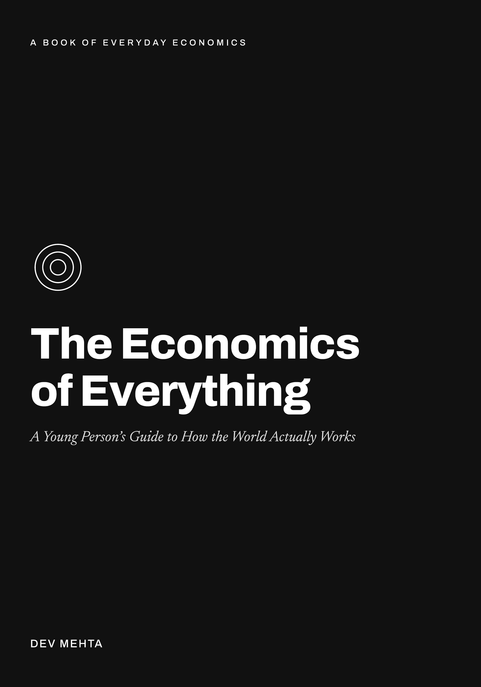
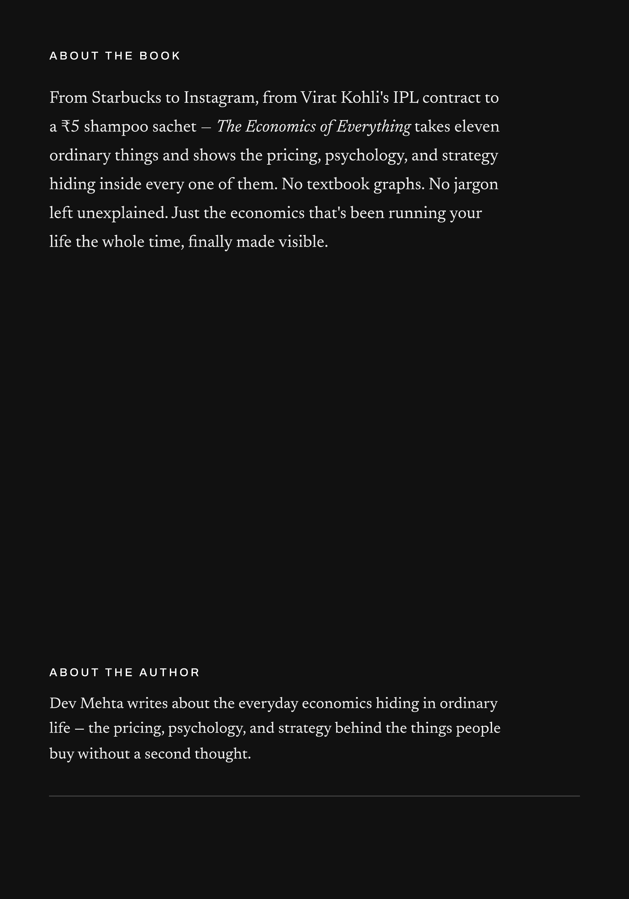

# The Economics of Everything

*A Young Person's Guide to How the World Actually Works*

**English Edition** · Dev Mehta

[🏠 Home](../README.md) · [🌍 Other languages](../README.md#-choose-your-language) · [📜 License](../LICENSE)

---

> Eleven everyday things, from a Starbucks coffee to a ₹5 shampoo sachet, and the pricing, psychology and strategy hiding inside every one of them.

## 📚 Table of Contents

- **[Introduction](00-introduction.md)** — Why This Book Exists

1. **[Why Starbucks Costs So Much](01-starbucks.md)**
2. **[Why Your Netflix Bill Keeps Going Up — And Why You Never Cancel](02-netflix.md)**
3. **[Why the Same Flight Ticket Has 200 Different Prices](03-flight-tickets.md)**
4. **[Why an iPhone Costs ₹1,20,000 — And Why You Still Want One](04-iphone.md)**
5. **[Why Virat Kohli Earns More in One IPL Season Than a Doctor Does in a Lifetime](05-virat-kohli.md)**
6. **[Why Zomato Delivers Your Biryani at ₹30 and Still Loses Money](06-zomato.md)**
7. **[Why Gold Prices Never Really Fall in India](07-gold.md)**
8. **[How UPI Changed the Economics of Money — And Why the World Is Copying India](08-upi.md)**
9. **[Why Your Movie Ticket Costs ₹1,500 on Friday and ₹300 on Tuesday](09-movie-tickets.md)**
10. **[How HUL Makes Billions Selling ₹5 Sachets](10-hul-sachets.md)**
11. **[How Instagram Created an Economy Worth Billions — and Why Your Attention Is the Product](11-instagram.md)**

- **[Conclusion](12-conclusion.md)** — The World Was Pricing You All Along
- **[Notes & Sources](13-notes-and-sources.md)**

---

## 👤 Author

**Dev Mehta**

Back cover

 

> Found an error in this edition? [Open an issue](https://github.com/devmehta392-prog/The-Economics-of-Everything/issues)

---

[**Start reading: Introduction →**](00-introduction.md)

