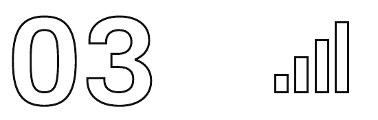

[🏠 મુખ્ય પૃષ્ઠ](../README.md) › [📚 અનુક્રમણિકા](README.md) › પ્રકરણ 3

---

# એક જ ફ્લાઇટ ટિકિટના 200 અલગ-અલગ ભાવ કેમ હોય છે

કોઈ પણ ફ્લાઇટ ઍપ ખોલો. મુંબઈથી દિલ્હી, આવતો શુક્રવાર સર્ચ કરો.

₹4,800. તમે નોંધી લો છો.

ઍપ બંધ કરો. કાલે સવારે ફરી ખોલો.

₹6,600. એ જ ફ્લાઇટ. એ જ સીટ ક્લાસ. એ જ તારીખ. તમે કશું કર્યું નથી. તમે ઊંઘતા હતા અને ભાવ ₹1,800 ઊછળી ગયો.

હવે તમારા મિત્રને કહો કે અત્યારે જ પોતાના ફોન પર આ જ ફ્લાઇટ સર્ચ કરે. એકબીજાને ભાવ બતાવો. ફરી જુદા ભાવ. કદાચ.

આ કોઈ ગરબડ નથી. આ અત્યાર સુધી બનેલી સૌથી અત્યાધુનિક પ્રાઇસિંગ સિસ્ટમમાંની એક છે — અને એક વાર તમે તેને સમજી લેશો, પછી તમે ક્યારેય પહેલાંની જેમ ફ્લાઇટ બુક નહીં કરો.

> **આંકડામાં**
>
> **ઍરલાઇનના ભાવમાં ઊથલપાથલનું પ્રમાણ**
>
> ઇન્ડિગોની એક જ મુંબઈ–દિલ્હી ફ્લાઇટમાં, બાજુબાજુમાં બેઠેલા જુદા જુદા મુસાફરોએ ₹1,800થી લઈને ₹18,000 સુધી કંઈ પણ ચૂકવ્યું હોઈ શકે — બિલકુલ એ જ વિમાન, મંજિલ, ક્રૂ, બળતણ અને ઉડાનના સમય માટે ભાવમાં 10 ગણો તફાવત. સીટ 14C બિલકુલ એવી જ છે, ભલે તમે તેના ₹2,200 આપ્યા હોય કે ₹12,000. તફાવતનો દરેક રૂપિયો શુદ્ધ પ્રાઇસિંગ વ્યૂહરચના છે.

## એ આર્થિક હકીકત જે બધું બદલી નાખે છે

ઊડી ગયેલી ફ્લાઇટની ખાલી સીટની કિંમત બરાબર શૂન્ય છે. કાયમ માટે.

ન વેચાયેલા સ્ટૉકવાળો કપડાંનો વેપારી સેલ કરી શકે છે, માલ આઉટલેટમાં મોકલી શકે છે, આવતા વર્ષ માટે રાખી શકે છે. રાતે 9 વાગ્યે વધેલા ખાવાવાળું રેસ્ટોરન્ટ તેને ડિસ્કાઉન્ટમાં વેચી શકે છે, કાલની તૈયારીમાં વાપરી શકે છે, સ્ટાફને આપી શકે છે. વધારાના માલવાળી ફોન કંપની કિંમતો ઘટાડી શકે છે કે માલ રોકી રાખી શકે છે.

ઍરલાઇન પાસે આમાંનો એક પણ વિકલ્પ નથી. જે ક્ષણે કૅબિનનો દરવાજો બંધ થાય છે, દરેક ખાલી સીટ એક કાયમી, ક્યારેય ન વસૂલાય એવું નુકસાન બની જાય છે. સીટને સાચવી શકાતી નથી. કાલની ફ્લાઇટમાં ખસેડી શકાતી નથી. એ વરાળ બનીને ઊડી જાય છે — અને ઍરલાઇનને તેની પડતર બરાબર એટલી જ પડે છે જેટલી પૂરું ભાડું ભરનાર મુસાફર બેઠો હોત તો પડત.

આ અસમાનતા — ભારે સ્થિર ખર્ચ (fixed cost), અને દરેક વધારાના મુસાફર પર લગભગ શૂન્ય પરિવર્તી ખર્ચ (variable cost) — એક એવી પ્રાઇસિંગ મજબૂરી ઊભી કરે છે જે બીજા કોઈ ઉદ્યોગમાં નથી: દરેક સીટ એ મહત્તમ કિંમતે ભરો જે દરેક ચોક્કસ ખરીદનાર ચૂકવશે, કારણ કે સીટ ન ભરવાની કિંમત છે આખી આવકનું નુકસાન, અને શૂન્યથી ઉપરની કોઈ પણ કિંમતે તેને ભરવાનો ખર્ચ લગભગ કશો નથી.

| પ્રોડક્ટ | પીક પછી ન વેચાય તો... | વસૂલાતના વિકલ્પો | એક વધુ વેચાણનો સીમાંત ખર્ચ |
| :--- | :--- | :--- | :--- |
| ટી-શર્ટ (રિટેલ) | ફૅશન સીઝન પૂરી | સેલ, આઉટલેટ, આગલી સીઝન | ઉત્પાદન ખર્ચ |
| રેસ્ટોરન્ટનું ભોજન | રાતે 9 વાગ્યે વધેલું ખાવાનું | ડિસ્કાઉન્ટ, સ્ટાફનું ભોજન, કાલની તૈયારી | સામગ્રી + થોડી મજૂરી |
| હોટેલનો રૂમ | રાત વીતી ગઈ | કોઈ નહીં — રાત ફરી નથી આવતી | સફાઈ, વીજળી-પાણી |
| ઍરલાઇન સીટ | ઉડાનનો દરવાજો બંધ | કોઈ નહીં — કાયમ માટે શૂન્ય | એક ભોજન + થોડા ગ્રામ બળતણ |

*કોઈ પણ ઉદ્યોગમાં જલદી બગડી જતી વસ્તુઓ (perishable goods)ના અર્થશાસ્ત્રનું સૌથી કઠોર સ્વરૂપ ઍરલાઇનોએ વેઠવું પડે છે*

## યીલ્ડ મૅનેજમેન્ટ: એક પ્રોડક્ટને 200 ભાવે વેચવી

ઍરલાઇનોએ 'બગડી જતી સીટ'ની સમસ્યા યીલ્ડ મૅનેજમેન્ટ (yield management) શોધીને ઉકેલી — કોઈ પણ સામાન્ય ગ્રાહક પ્રોડક્ટ પર લાગુ કરાયેલી અત્યાર સુધીની સૌથી અત્યાધુનિક રિયલ-ટાઇમ પ્રાઇસિંગ સિસ્ટમ. તે 1980ના દાયકામાં અમેરિકન ઍરલાઇન્સે વિકસાવી હતી. આજે તેનાં સ્વરૂપો હોટેલો, રાઇડ-શેરિંગ, કૉન્સર્ટ ટિકિટિંગ અને સ્ટ્રીમિંગમાં વપરાય છે.

દરેક ફ્લાઇટ અદૃશ્ય 'પ્રાઇસિંગ બકેટ' સાથે ચાલે છે — નીચે સૌથી સસ્તીથી લઈને ઉપર સૌથી મોંઘી સુધી. જ્યારે બુકિંગ ખૂલે છે, ત્યારે સૌથી સસ્તું બકેટ ઉપલબ્ધ હોય છે. ચાર મહિના પહેલાં બુક કરનાર મુસાફરને ₹1,800માં ટિકિટ મળે છે. જેમ જેમ સસ્તી સીટો વેચાતી જાય છે, સિસ્ટમ ખરીદનારાઓને આગલા પ્રાઇસ બકેટમાં મોકલી દે છે. બે અઠવાડિયાં પછી સર્ચ કરનાર વ્યક્તિ એટલા માટે વધુ નથી ચૂકવતી કે સીટ બદલાઈ ગઈ — એ એટલા માટે વધુ ચૂકવે છે કે પહેલાં આવેલા, કિંમત બાબતે સભાન ખરીદનારાઓએ સસ્તી સીટો ખતમ કરી નાખી.

> **સંકલ્પના**
>
> **યીલ્ડ મૅનેજમેન્ટ (Yield Management)**
>
> એક પ્રાઇસિંગ વ્યૂહરચના જે માંગના સ્તર, ખરીદનારના વર્તન અને પ્રોડક્ટની મુદત પૂરી થવામાં બાકી સમયના આધારે રિયલ ટાઇમમાં કિંમતો બદલે છે. ઍરલાઇનોએ તે શોધી. હોટેલોએ તેને નિખારી (એટલે જ નવા વર્ષની આગલી રાતે મુંબઈની મૅરિયટ બમણી મોંઘી હોય છે). ઉબર તેને સર્જ પ્રાઇસિંગ તરીકે વાપરે છે. બુકમાયશો તેને કૉન્સર્ટ માટે વાપરે છે. લક્ષ્ય: દરેક ખરીદનાર પાસેથી બરાબર એટલું લઈને, જેટલું તે ચૂકવવા તૈયાર છે, કુલ આવક મહત્તમ કરવી.

> **વચ્ચે એક વાત**
>
> *ઍરલાઇનનું પ્રાઇસિંગ એલ્ગોરિધમ તમને અંગત રીતે નથી ઓળખતું. તેને બસ એટલી ખબર છે કે કોઈએ આ અઠવાડિયે એક જ ફ્લાઇટ ત્રણ વાર સર્ચ કરી અને હજી બુક નથી કરી. યીલ્ડ મૅનેજમેન્ટમાં આ પૅટર્નનું એક નામ છે: 'હાઇ-ઇન્ટેન્ટ, હાઇ-વિલિંગનેસ' (પાક્કો ઇરાદો, ચૂકવવાની વધુ તૈયારી). એલ્ગોરિધમ નિર્દય નથી. એ બસ પોતાના કામમાં અત્યંત, યાંત્રિક રીતે પાવરધું છે.*

## મંગળવાર શુક્રવાર કરતાં સસ્તો કેમ હોય છે (આ સંજોગ નથી)

એ જ રૂટ. એ જ વિમાન. એ જ ક્રૂ. એટલું જ બળતણ. છતાં શુક્રવારની સાંજ કરતાં મંગળવારની બપોરે ઘણું વધારે સસ્તું. આ એ આધારે થતો વ્યવસ્થિત ભાવ-ભેદભાવ છે કે દરેક દિવસે સીટો પર ખરેખર કોણ બેઠું છે.

ઍરલાઇન ઉદ્યોગે દાયકાઓ સુધી ગ્રાહકોના પ્રકાર અને તેમના બુકિંગ વર્તનનો બારીકાઈથી નકશો બનાવ્યો છે. બિઝનેસ મુસાફરો ઉડાનની નજીક બુક કરે છે, ચોક્કસ દિવસોએ ઊડે છે કારણ કે મીટિંગ ટાળી શકાતી નથી, અને પોતાના ખિસ્સામાંથી પૈસા નથી ચૂકવતા. ફરવા જતા મુસાફરો અઠવાડિયાં કે મહિનાઓ પહેલાં બુક કરે છે, પૈસા બચાવવા તારીખો બે-ત્રણ દિવસ આગળ-પાછળ કરી શકે છે, અને ખર્ચનો દરેક રૂપિયો અનુભવે છે કારણ કે એ તેમની પોતાની બચતમાંથી જાય છે. આ બંને પ્રકારના ગ્રાહકોનું વર્તન લગભગ સંપૂર્ણપણે ઊલટું છે — અને પ્રાઇસિંગ એલ્ગોરિધમ આ તફાવતના દરેક પાસાનો લાભ ઉઠાવે છે.

| લાક્ષણિકતા | બિઝનેસ મુસાફર | ફરવા જતા / વિદ્યાર્થી મુસાફર |
| :--- | :--- | :--- |
| સામાન્ય મુસાફરીના દિવસો | સોમવારની સવાર, શુક્રવારની સાંજ | જ્યારે પણ સૌથી સસ્તું હોય |
| બુકિંગનો સમય | ઉડાનના 0–14 દિવસ પહેલાં | અઠવાડિયાં કે મહિનાઓ પહેલાં |
| પૈસા કોણ ચૂકવે છે? | નોકરીદાતા (કંપનીનો ખર્ચ) | પોતાની બચત |
| કિંમત પ્રત્યે સંવેદનશીલતા | બહુ ઓછી — મીટિંગ ટાળી શકાતી નથી | બહુ વધારે — ₹1,500 બચાવવા તારીખો બદલી નાખશે |
| લવચીકતા | કોઈ નહીં — સમયપત્રક કામથી નક્કી છે | વધારે — શુક્રવારને બદલે મંગળવારે ઊડી શકે |
| આર્થિક શબ્દ | કિંમત સામે અસ્થિતિસ્થાપક માંગ | કિંમત સામે સ્થિતિસ્થાપક માંગ |

*ઊલટા અર્થશાસ્ત્રવાળા બે પ્રકારના મુસાફરો — ઍરલાઇનો આ તફાવતનો વ્યવસ્થિત રીતે લાભ ઉઠાવે છે*

> **વચ્ચે એક વાત**
>
> *કંપનીના પૈસે ઊડતા બિઝનેસ મુસાફરો, આર્થિક રીતે જોઈએ તો, ઍરલાઇન ઉદ્યોગના સૌથી મૂલ્યવાન ગ્રાહકો છે. ₹3,200ની દરેક સસ્તી ટિકિટ એટલા માટે અસ્તિત્વમાં છે કે ક્યાંક કોઈનો નોકરીદાતા એ જ ફ્લાઇટની એ જ સીટના ₹18,000 ચૂકવી રહ્યો છે. આવતી વખતે તમને સસ્તી ટિકિટ મળે, ત્યારે એ રૂટ પર પૂરું ભાડું ભરનારા બધા બિઝનેસ મુસાફરોનો ચૂપચાપ આભાર માનજો.*

આ ત્રીજા પ્રકારનો ભાવ-ભેદભાવ છે — દેખાતી માંગની લાક્ષણિકતાઓના આધારે અલગ ઓળખી શકાય તેવા જૂથો પાસેથી અલગ અલગ કિંમત લેવી. ઍરલાઇન એમ નથી પૂછતી કે 'શું તમે બિઝનેસ મુસાફર છો?' એ સંકેતોનો ઉપયોગ કરે છે: શુક્રવારની સાંજ વિરુદ્ધ મંગળવારની બપોર, બે અઠવાડિયાં પહેલાંનું બુકિંગ વિરુદ્ધ ત્રણ મહિના પહેલાંનું. એ જ વિમાન. એ જ અંતર. તદ્દન અલગ આર્થિક મૂલ્યની વસૂલાત.

## ઇન્ડિગોએ ભારતીય ઉડ્ડયનનું અર્થશાસ્ત્ર કેવી રીતે ફરી લખ્યું

2006 પહેલાં ભારતમાં હવાઈ મુસાફરી શ્રીમંતો અને કૉર્પોરેટ લોકો માટે અનામત એક સ્ટેટસ સિમ્બોલ હતી. ઇન્ડિગો લો-કૉસ્ટ કૅરિયર મૉડલ સાથે આવી: ફક્ત એક જ પ્રકારનું વિમાન (જાળવણીની જટિલતા ઓછી), ગેટ પર 60ને બદલે 25 મિનિટમાં વિમાન ફરી તૈયાર કરવું (દરેક વિમાનની રોજની વધુ ઉડાન), કોઈ મફત ભોજન નહીં, સીટ પસંદગી સામેલ નહીં, અને દરેક વૈકલ્પિક સુવિધા અલગથી વેચાય.

બેઝ ભાડું એ ચારો છે. વધારાની આવક ઍડ-ઑનમાંથી આવે છે — સીટ પસંદગી (₹200–700), ચેક-ઇન બૅગેજ (₹500–1,500), ઍરપોર્ટ પર ભોજન (₹300–600), પ્રાથમિકતાવાળું બોર્ડિંગ. આજે ભારતના સ્થાનિક ઉડ્ડયન બજારના 60%થી વધુ હિસ્સા પર ઇન્ડિગોનો કબજો છે — દુનિયાના કોઈ પણ મોટા ઉડ્ડયન બજારમાં કોઈ એક ઍરલાઇનનો સૌથી મોટો હિસ્સો.

2000માં ભારતમાં દર વર્ષે આશરે 2.5 કરોડ હવાઈ મુસાફરો હતા. 2023 સુધીમાં આ સંખ્યા 15.2 કરોડ થઈ. ઇન્ડિગોએ શરૂ કરેલા લો-કૉસ્ટ મૉડલે હવાઈ મુસાફરીને ભારતીય મધ્યમ વર્ગની પહોંચમાં એ રીતે લાવી દીધી, જે 2006 પહેલાં ખરેખર શક્ય નહોતું.

ઇન્ડિગોએ શું બનાવ્યું એ સમજવા માટે તેની સરખામણી પહેલાંના સમય સાથે કરો. ઍર ઇન્ડિયા — સરકારી માલિકીની જૂની ઍરલાઇન — એક સરકારી સંસ્થાના ખર્ચ માળખા અને સેવાની માનસિકતા સાથે ચાલતી હતી: કર્મચારીઓ માટે ઉદાર સુવિધાઓ, દરેક ફ્લાઇટમાં ફુલ-સર્વિસ ભોજન, જુદા જુદા પ્રકારનાં વિમાનોનો મોટો કાફલો જેમાંના દરેક માટે અલગ જાળવણી સર્ટિફિકેશન અને અલગ સ્પેર પાર્ટ્સ જોઈએ, અને એક એવી સંસ્થાની સંસ્થાગત જડતા જેને ગ્રાહકો માટે ક્યારેય ગંભીરતાથી સ્પર્ધા કરવાની જરૂર જ નહોતી પડી. ઍર ઇન્ડિયાનો ઉપલબ્ધ સીટ કિલોમીટર દીઠ ખર્ચ — ઉડ્ડયન કાર્યક્ષમતાનો પ્રમાણભૂત માપદંડ — ઇન્ડિગો કરતાં ઘણો વધારે હતો. જ્યારે લો-કૉસ્ટ ઍરલાઇનો આવી, ત્યારે ઍર ઇન્ડિયા દરેક સીટ પર ખોટ ખાધા વગર તેમની કિંમતોની બરાબરી કરી શકી નહીં, અને પોતાની સેવાનો તફાવત પણ જાળવી શકી નહીં, કારણ કે મુસાફરો એ મામૂલી સેવા-લાભને બદલે સતત કિંમતને પસંદ કરવા લાગ્યા.

ઇન્ડિગો મૉડલે ઍરલાઇન અને તેના ખર્ચ માળખા વચ્ચે એક જુદો સંબંધ પણ રજૂ કર્યો. ફક્ત ઍરબસ A320 પરિવારનાં વિમાનો ઉડાડવાથી ઇન્ડિગોને પાઇલટ માટે એક જ પ્રકારનું ટાઇપ રેટિંગ, એક જ જાળવણી તાલીમ કાર્યક્રમ, અને સ્પેર પાર્ટ્સનો એક જ ભંડાર જોઈતો હતો. A320 માટે લાયક પાઇલટ કાફલાનું કોઈ પણ ઇન્ડિગો વિમાન ઉડાડી શકે છે. A320 એન્જિન પર તાલીમ પામેલો ટેક્નિશિયન કાફલાના કોઈ પણ એન્જિનની સર્વિસ કરી શકે છે. આ માનકીકરણે એવો ખર્ચ-લાભ ઊભો કર્યો જે સમય સાથે વધતો ગયો: તાલીમનો ઓછો ખર્ચ, સંપત્તિનો વધુ ઉપયોગ, સરળ સમયપત્રક, અને ઍરબસ સાથે જથ્થાબંધ ખરીદીની મોટી તાકાત — ઇન્ડિગો ઐતિહાસિક રીતે દુનિયાભરમાં ઍરબસના સૌથી મોટા એકલ ગ્રાહકોમાંની એક રહી છે, જેનાથી તેને કિંમત પર એવું વર્ચસ્વ મળે છે જે મિશ્ર કાફલાવાળી નાની ઍરલાઇનો ક્યારેય મેળવી શકતી નથી.

## એલ્ગોરિધમને ખરેખર કેવી રીતે માત આપવી

| વ્યૂહરચના | આ કેમ કામ કરે છે | સામાન્ય બચત |
| :--- | :--- | :--- |
| 6–8 અઠવાડિયાં પહેલાં બુક કરો | સસ્તાં બકેટ હજી ખુલ્લાં છે, એલ્ગોરિધમ ગભરાટવાળો ભાવ નથી લગાડતું | એ જ દિવસની સરખામણીમાં 30–50% |
| મંગળવાર/બુધવારે ઊડો | ફરવા જનારાઓનો પ્રાઇસિંગ સેગમેન્ટ, બિઝનેસવાળો નહીં | શુક્રવારની સરખામણીમાં 20–40% |
| ઇન્કૉગ્નિટો મોડમાં સર્ચ કરો | વારંવાર સર્ચથી બનતો માંગનો સંકેત ટળે છે | અલગ અલગ, પણ હંમેશાં કરવા જેવું |
| સવારની ફ્લાઇટ | ઓછી માંગ, એલ્ગોરિધમનો ઓછો ભાવ | સાંજની સરખામણીમાં 10–20% |
| તારીખોમાં ±3 દિવસની છૂટ | ગૂગલ ફ્લાઇટ્સ રેન્જમાં સૌથી સસ્તો દિવસ બતાવે છે | સામાન્ય રીતે ₹1,000–3,000 |
| 500 કિમીથી ઓછા માટે ટ્રેન સાથે સરખામણી કરો | ઍરપોર્ટ પર જતો સમય ઘણી વાર ટ્રેનની સરખામણીમાં ખોટનો સોદો | ક્યારેક ઊડવું ફાયદાકારક નથી |

*સિસ્ટમનો તર્ક તેની જ સામે વાપરો — એલ્ગોરિધમને તમારા પ્રત્યે કોઈ વફાદારી નથી*

આમાંની દરેક વ્યૂહરચના એટલા માટે કામ કરે છે કે તે યીલ્ડ મૅનેજમેન્ટ એલ્ગોરિધમના આંતરિક તર્કનો લાભ ઉઠાવે છે. એલ્ગોરિધમ એ રીતે બન્યું છે કે દરેક આવતા બુકિંગમાંથી મહત્તમ આવક કાઢે — તે તમને સારો સોદો આપવા માટે નથી બન્યું. પણ તે નિયમો પર ચાલે છે, એટલે નિયમો સમજવાનો અર્થ એ છે કે તમે તમારા બુકિંગનો સમય અને રીત એવી રીતે નક્કી કરી શકો કે તે સસ્તા પ્રાઇસિંગ બકેટમાં પડે.

ઇન્કૉગ્નિટો મોડવાળી વાત પર ખાસ વિસ્તારથી વાત થવી જોઈએ, કારણ કે તેના વિશે ઘણી ગેરસમજ છે. વારંવાર સર્ચ કરવાથી ભાવ વધવાના પુરાવા મિશ્ર છે — અમુક ઍરલાઇનો અને બુકિંગ પ્લેટફૉર્મ ચોક્કસપણે કૂકી-આધારિત માંગ-સંકેતો વાપરે છે; અમુક નથી વાપરતાં. જે નક્કી છે એ એ કે ઇન્કૉગ્નિટો મોડ વાપરવામાં તમારું કશું જતું નથી અને કદાચ સેંકડો રૂપિયા બચી જાય, એટલે એ હંમેશાં કરવા જેવું છે. એનાથી પણ મહત્ત્વની વાત, અનેક પ્લેટફૉર્મ પર ભાવની સરખામણી કરવી — ફક્ત એક ઍપ પર નહીં — સતત એક જ ફ્લાઇટના ભાવમાં તફાવત બતાવે છે. ઍરલાઇનની વેબસાઇટો, મેકમાયટ્રિપ, ક્લિયરટ્રિપ, ઇક્સિગો અને ગૂગલ ફ્લાઇટ્સ ઘણી વાર એક જ રૂટના જુદા જુદા ભાવ બતાવે છે, કારણ કે દરેકના ઍરલાઇનો સાથે અલગ વ્યાવસાયિક કરારો અને રિયલ-ટાઇમ સીટો સુધી અલગ પહોંચ હોય છે. બે-ત્રણ જગ્યાએ તપાસવામાં પાંચ મિનિટ વધુ લાગે છે, અને રૂપિયામાં ઘણી વાર એ મહેનત કરતાં વધુની બચત થઈ જાય છે.

'એલ્ગોરિધમને કેવી રીતે માત આપવી'ની ચર્ચામાં એક વૈચારિક પાઠ પણ છે, જે ફ્લાઇટ બુકિંગથી ઘણે આગળ લાગુ પડે છે. એક વાર તમે સમજી જાઓ કે તમને દેખાતી કિંમત કોઈ તટસ્થ, વસ્તુનિષ્ઠ હકીકત નથી, પણ એવી સિસ્ટમનું આઉટપુટ છે જે એ ક્ષણે તમારા અને બજાર વિશેની માહિતીના આધારે વેચનારની આવક મહત્તમ કરવા બની છે — તો તમે દરેક કિંમતને જુદી નજરે જોવા લાગો છો. કારનો સ્ટિકર પ્રાઇસ. ઇન્શ્યોરન્સ રિન્યુઅલનું પ્રીમિયમ. કૉન્ટ્રાક્ટરનું પહેલું ક્વોટેશન. બૅન્કે ઑફર કરેલો વ્યાજદર. આ બધી શરૂઆતી બોલીઓ છે, જે એ હિસાબે નક્કી થઈ છે કે વેચનારને લાગે છે તમે શું સ્વીકારી લેશો. દરેક કિસ્સામાં વધુ માહિતી અને વિકલ્પોની સરખામણી કરવાની તૈયારી તાકાતને ખરીદનાર તરફ ખસેડે છે. આ રોજિંદા આર્થિક જીવનમાં અર્થશાસ્ત્રના સૌથી વ્યવહારુ ઉપયોગોમાંનો એક છે.

> **નિષ્કર્ષ**
>
> તમારા માટે આનો અર્થ: તમને દેખાતો દરેક ફ્લાઇટ ભાવ એક એલ્ગોરિધમનું પરિણામ છે, જે તમારી સર્ચ હિસ્ટરી, દિવસ, સમય, બાકી સીટો અને ડઝનબંધ બીજાં પરિબળોના આધારે ગણે છે કે તમે ખાસ કરીને, એ ખાસ ક્ષણે, કેટલું ચૂકવવા તૈયાર છો. તેને તમારા પ્રત્યે કોઈ વફાદારી નથી. ઇન્કૉગ્નિટો મોડ વાપરો, શક્ય હોય ત્યાં તારીખોમાં છૂટ રાખો, અને ત્યારે બુક કરો જ્યારે એલ્ગોરિધમ તમને એક જ રૂટ વારંવાર સર્ચ કરતા ન જોતું હોય.

---

### ✅ ઝડપી ચકાસણી

*જોઈએ, તમે ખરેખર વાંચ્યું કે ફક્ત ટેબલ જ જોતા રહ્યા...*

**1. ઉડાન વખતે ઍરલાઇનની ખાલી સીટની કિંમત બરાબર શૂન્ય કેમ હોય છે?**

- **A** — કારણ કે ઍરલાઇનો ન વેચાયેલી સીટોનો હિસાબ નથી રાખતી
- **B** — કારણ કે એ એક કાયમી, ક્યારેય ન વસૂલાય એવું આવકનું નુકસાન છે — તેને ન સાચવી શકાય, ન ખસેડી શકાય, ન પછી વેચી શકાય
- **C** — કારણ કે ઍરલાઇનો બાજુની ખાલી સીટો માટે રિફંડ આપે છે
- **D** — કારણ કે સીટ બનાવવાના ખર્ચનું પૂરું ઘસારા-મૂલ્ય પહેલેથી ગણાઈ ગયું છે

**2. યીલ્ડ મૅનેજમેન્ટનું મુખ્ય લક્ષ્ય છે:**

- **A** — દરેક મુસાફર દીઠ બળતણની કાર્યક્ષમતા મહત્તમ કરવી
- **B** — ન્યાય માટે બધા મુસાફરો સરખી કિંમત ચૂકવે એની ખાતરી કરવી
- **C** — દરેક ખરીદનાર પાસેથી એટલું લઈને જેટલું તે ચૂકવવા તૈયાર છે, કુલ આવક મહત્તમ કરવી
- **D** — DGCAના સ્થાનિક ભાડાના નિયમોનું પાલન કરવું

**3. બિઝનેસ મુસાફરો એક જ સીટ માટે ફરવા જતા મુસાફરો કરતાં સતત વધુ કેમ ચૂકવે છે?**

- **A** — તેમને કિંમતમાં સામેલ મોટી સીટો અને વધુ સારું ભોજન મળે છે
- **B** — તેઓ સામાન્ય રીતે છેલ્લી ઘડીએ બુક કરે છે અને કિંમત પ્રત્યે ઓછા સંવેદનશીલ હોય છે કારણ કે પૈસા બીજું કોઈ ચૂકવે છે
- **C** — ઍરલાઇનો બિઝનેસ અકાઉન્ટ પર કૉર્પોરેટ ગ્રાહક સરચાર્જ લગાડે છે
- **D** — બિઝનેસ ક્લાસ રૂટ પર બળતણ અને નેવિગેશનનો ખર્ચ વધુ હોય છે

**4. ઇન્ડિગોનું લો-કૉસ્ટ કૅરિયર મૉડલ મુખ્યત્વે એટલા માટે કામ કરે છે કે:**

- **A** — ઇન્ડિગો ફુલ-સર્વિસ ઍરલાઇનો કરતાં ઘણાં જૂનાં અને સસ્તાં વિમાનો વાપરે છે
- **B** — ઇન્ડિગોના પાઇલટનો પગાર ઍર ઇન્ડિયા કરતાં ઘણો ઓછો છે
- **C** — સરકાર ઇન્ડિગોને બળતણ ખર્ચ પર સબસિડી આપે છે
- **D** — બેઝ ભાડું આકર્ષક રીતે ઓછું રખાય છે, જ્યારે આવક વૈકલ્પિક પેઇડ ઍડ-ઑનમાંથી આવે છે

<b>જવાબ જુઓ</b>

1. **B** — કારણ કે એ એક કાયમી, ક્યારેય ન વસૂલાય એવું આવકનું નુકસાન છે — તેને ન સાચવી શકાય, ન ખસેડી શકાય, ન પછી વેચી શકાય
2. **C** — દરેક ખરીદનાર પાસેથી એટલું લઈને જેટલું તે ચૂકવવા તૈયાર છે, કુલ આવક મહત્તમ કરવી
3. **B** — તેઓ સામાન્ય રીતે છેલ્લી ઘડીએ બુક કરે છે અને કિંમત પ્રત્યે ઓછા સંવેદનશીલ હોય છે કારણ કે પૈસા બીજું કોઈ ચૂકવે છે
4. **D** — બેઝ ભાડું આકર્ષક રીતે ઓછું રખાય છે, જ્યારે આવક વૈકલ્પિક પેઇડ ઍડ-ઑનમાંથી આવે છે

---

[← પ્રકરણ 2](02-netflix.md) · [📚 અનુક્રમણિકા](README.md) · [આગળ: પ્રકરણ 4 →](04-iphone.md)

