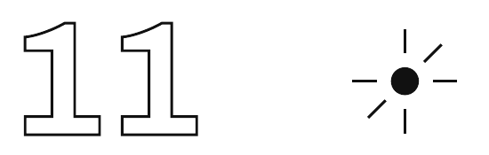

[🏠 મુખ્ય પૃષ્ઠ](../README.md) › [📚 અનુક્રમણિકા](README.md) › પ્રકરણ 11

---

# ઇન્સ્ટાગ્રામે અબજોનું અર્થતંત્ર કેવી રીતે ઊભું કર્યું — અને તમારું ધ્યાન જ પ્રોડક્ટ કેમ છે

મુંબઈની એક 22 વર્ષની યુવતી પોતાના ફ્લૅટમાંથી મેકઅપ ટ્યૂટોરિયલ પોસ્ટ કરે છે. ન ડિગ્રી, ન કૉર્પોરેટ નોકરી, ન માર્કેટિંગ બજેટ. આજે તે ટોચની બિઝનેસ સ્કૂલોના મોટા ભાગના MBA કરતાં વધુ કમાય છે.

જયપુરનો એક યુવાન ભારતનાં ટિયર-2 શહેરોના સ્ટ્રીટ ફૂડનો રિવ્યૂ કરે છે. 32 લાખ યુટ્યૂબ સબ્સ્ક્રાઇબર. ઍરલાઇન્સ, ફૂડ ડિલિવરી પ્લેટફૉર્મ, પ્રવાસન બોર્ડ અને પૅકેજ્ડ ફૂડ કંપનીઓ સાથે બ્રાન્ડ ડીલ.

ઉત્તર પ્રદેશનો એક ખેડૂત હિન્દીમાં ઑર્ગેનિક ખેતીની પદ્ધતિઓ પર વીડિયો પોસ્ટ કરે છે. 1.8 કરોડ યુટ્યૂબ સબ્સ્ક્રાઇબર. માસિક આવક: મોટા ભાગના કૉર્પોરેટ વાઇસ પ્રેસિડેન્ટ્સ કરતાં વધુ.

આ જ ક્રિએટર ઇકૉનૉમી છે — અને આ કોઈ સાંસ્કૃતિક કુતૂહલ કે પરંપરાગત સેલિબ્રિટી સંસ્કૃતિનું વિસ્તરણ નથી. આ ખરેખર એક નવી આર્થિક વ્યવસ્થા છે, જે ધ્યાન, ભરોસા અને નેટવર્ક ઇફેક્ટના એવા શક્તિશાળી સિદ્ધાંતો પર બની છે કે તેણે ₹15,000 કે તેથી ઓછાનાં ઓજારોથી વૈશ્વિક સંગીત ઉદ્યોગ કરતાં વધુ વાર્ષિક આવક પેદા કરી છે.

> **વચ્ચે એક વાત**
>
> *જયપુરનો એક યુવાન સ્ટ્રીટ ફૂડનો રિવ્યૂ કરે છે. તેના યુટ્યૂબ સબ્સ્ક્રાઇબર અનેક દેશોની વસ્તી કરતાં વધુ છે. તેની કમાણી વીસ વર્ષના અનુભવવાળા મોટા ભાગના કૉર્પોરેટ VPને શરમાવે એવી છે. તેણે આ જયપુરથી કર્યું. એક ફોનથી. અર્થશાસ્ત્ર કમાલનું છે, અને તકો ક્યાં રહે છે તેના જૂના નિયમો આપણી નજર સામે ફરી લખાઈ રહ્યા છે.*

| પ્લેટફૉર્મ | ભારતમાં માસિક સક્રિય યુઝર | મુખ્ય ફૉર્મેટ | ક્રિએટર કેવી રીતે કમાય છે |
| :--- | :--- | :--- | :--- |
| યુટ્યૂબ | ~46.2 કરોડ | લાંબા વીડિયો | AdSense + બ્રાન્ડ ડીલ + ચૅનલ મેમ્બરશિપ |
| ઇન્સ્ટાગ્રામ | ~31.4 કરોડ | ફોટા + રીલ્સ + સ્ટોરીઝ | બ્રાન્ડ પાર્ટનરશિપ + ઍફિલિએટ લિંક + ઇન્સ્ટાગ્રામ શૉપ્સ |
| ફેસબુક | ~32.9 કરોડ | મિશ્ર (યુવાનોમાં ઘટતું) | બ્રાન્ડ ડીલ + રીલ્સ બોનસ |
| શેરચૅટ/મોજ | ~35 કરોડ | ભારતીય ભાષાઓમાં ટૂંકા વીડિયો | ક્રિએટર ફંડ + બ્રાન્ડ ડીલ |
| જોશ | ~10 કરોડ | ટૂંકા વીડિયો (હિન્દી પહેલાં) | ક્રિએટર પ્રોગ્રામ + બ્રાન્ડ ડીલ |

*ભારતની ક્રિએટર ઇકૉનૉમી અનેક પ્લેટફૉર્મ પર ચાલે છે — દુનિયાનું સૌથી મોટું પ્રાદેશિક ભાષાઓવાળું ક્રિએટર બજાર*

## ઇન્સ્ટાગ્રામ ખરેખર શું વેચે છે (ફોટા નહીં)

2012માં ફેસબુક (હવે મેટા)એ ઇન્સ્ટાગ્રામને 1 અબજ ડૉલરમાં ખરીદ્યું. ઇન્ટરનેટે મોટે પાયે તેને આવક વગરની એક ફોટો-શેરિંગ ઍપ માટે ગાંડપણ ગણાવ્યું. એ જ ફોટો-શેરિંગ ઍપ આજે દર વર્ષે આશરે 50 અબજ ડૉલરની જાહેરાત આવક કમાય છે — મૂડીવાદના ઇતિહાસની સૌથી નફાકારક સૉફ્ટવેર પ્રોડક્ટ્સમાંની એક.

ઇન્સ્ટાગ્રામ ફોટા નથી વેચતું. તે ધ્યાન વેચે છે — ખાસ કરીને તમારું ધ્યાન, જેને પૅક કરીને એવા જાહેરાતકારોને વેચાય છે જે બરાબર એ ક્ષણે પોતાના વ્યાપારી સંદેશ સાથે તમારા સુધી પહોંચવા માગે છે જ્યારે તમારી સાવચેતી સૌથી ઓછી હોય અને તમે પ્રભાવ માટે સૌથી વધુ ખુલ્લા હો.

સ્ક્રોલ કરતાં વિતાવેલી દરેક મિનિટ એ મિનિટ છે જ્યારે તમારું ધ્યાન આર્થિક રીતે ઉપલબ્ધ હોય છે. પ્લેટફૉર્મ એ સમયને મૂલ્યવાન બનાવે છે — એવું વાતાવરણ ઘડીને જે એટલું અંગત, એટલું આદત પાડનારું, અને તમારી ચોક્કસ મનોવૈજ્ઞાનિક પ્રોફાઇલ પ્રમાણે એટલું સધાયેલું હોય કે અટકવું મુશ્કેલ લાગે. અનંત સ્ક્રોલ. બદલાતું ઇનામ (variable reward) — અનિશ્ચિતતા સતત મળતા ઇનામ કરતાં વધુ વ્યસન લગાડે છે. ડોપામાઇન જગાડતી નોટિફિકેશન સિસ્ટમ. 24 કલાકમાં ગાયબ થતું સ્ટોરીઝ ફૉર્મેટ, જે કૃત્રિમ ઉતાવળ ઊભી કરે છે.

મેટાની જાહેરાત પ્રણાલીને વિગતે સમજવી જરૂરી છે, કારણ કે તે બતાવે છે કે આધુનિક જાહેરાત ટેક્નોલૉજી કેટલી ચોક્કસ બની ગઈ છે. જ્યારે કોઈ કૉસ્મેટિક્સ બ્રાન્ડ તમને જાહેરાત બતાવવા મેટાને પૈસા ચૂકવે છે, ત્યારે તે એવી જગ્યા નથી ખરીદતી જે ઇન્સ્ટાગ્રામ પર સૌ સુધી પહોંચે. તે એક અત્યંત ચોક્કસ દર્શક વર્ગ સુધીની પહોંચ ખરીદે છે: 18–28 વર્ષની મહિલાઓ, જે મુંબઈ કે બેંગલુરુમાં રહે છે, જેમણે છેલ્લા 30 દિવસમાં સ્કિનકેર પ્રોડક્ટ્સ સર્ચ કરી છે, જે બ્યૂટી ક્રિએટર્સને ફૉલો કરે છે, જેમની કૌટુંબિક આવક પ્રીમિયમ ખરીદક્ષમતાનો સંકેત આપે છે, અને જેમણે તાજેતરમાં ત્વચાની કોઈ ચોક્કસ સમસ્યાવાળા કન્ટેન્ટ સાથે જોડાણ દેખાડ્યું છે. ટાર્ગેટિંગની આ જ ચોકસાઈ — જે ઇન્સ્ટાગ્રામે અબજો ઇન્ટરૅક્શનમાંથી એકઠા કરેલા વર્તન-ડેટાથી બનાવી છે — કારણ છે કે ઇન્સ્ટાગ્રામની જાહેરાત દર વર્ષે 50 અબજ ડૉલરની છે. જાહેરાતકાર બરાબર સાચી વ્યક્તિ સુધી બરાબર સાચી ક્ષણે પહોંચે છે, અને એ ચોકસાઈનું પ્રીમિયમ ચૂકવે છે.

જાહેરાતકાર ગ્રાહક છે. તમારું ધ્યાન પ્રોડક્ટ છે. આર્થિક અર્થમાં તમે ઇન્સ્ટાગ્રામના યુઝર નથી — તમે એ માલ છો જે વેચાઈ રહ્યો છે. આ કોઈ રૂપક નથી. આ શબ્દશઃ બિઝનેસ મૉડલ છે.

આ બિઝનેસ મૉડલના માળખાની અસરો અનેક દિશામાં ફેલાય છે. પ્લેટફૉર્મની આવક યુઝર્સ પાસેથી નહીં, જાહેરાતકારો પાસેથી આવે છે, એટલે પ્લેટફૉર્મનાં પ્રોત્સાહનો યુઝરનો સંતોષ નહીં, પણ જાહેરાતકારનો સંતોષ મહત્તમ કરવા સાથે જોડાયેલાં છે. આ હંમેશાં એક જ વસ્તુ નથી હોતી. જાહેરાતકારો ઓછામાં ઓછા ખર્ચે ગ્રહણશીલ દર્શકો સુધી મહત્તમ પહોંચ ઇચ્છે છે — જેનો અર્થ છે કે એલ્ગોરિધમે પ્લેટફૉર્મ પર વિતાવાતો સમય અને ભાવનાત્મક જોડાણ મહત્તમ કરવું જોઈએ, કારણ કે જોડાયેલા યુઝર જાહેરાત માટે વધુ ગ્રહણશીલ હોય છે. યુઝર્સ, જો તેમને પૂછવામાં આવે, તો એવું કન્ટેન્ટ જોવાનું પસંદ કરશે જે ખરેખર તેમનું જીવન સુધારે, તેમનું જ્ઞાન વધારે, કે તેમના સંબંધો મજબૂત કરે — જે હંમેશાં એ જ કન્ટેન્ટ નથી હોતું જે જોડાણનો સમય મહત્તમ કરે.

આ જ અસંગતતા સોશિયલ મીડિયા એલ્ગોરિધમની એ નોંધાયેલી વૃત્તિને સમજાવે છે, જેમાં તેઓ ભાવનાત્મક રીતે ઉશ્કેરણીજનક કન્ટેન્ટ — રોષ, ચિંતા, જૂથવાદ, સરખામણી અને હીનતા — ને શાંત, માહિતીપ્રદ કે ઊંડા શૈક્ષણિક કન્ટેન્ટ કરતાં વધુ ફેલાવે છે. એટલા માટે નહીં કે એલ્ગોરિધમ ખરાબ ઇરાદાવાળાં છે, પણ એટલા માટે કે ભાવનાત્મક રીતે ઉશ્કેરણીજનક કન્ટેન્ટ ધ્યાનને વધુ સમય પકડી રાખે છે, જોડાણના વધુ સંકેતો (કૉમેન્ટ, શેર, રિઍક્શન ઇમોજી) પેદા કરે છે, અને એટલે એલ્ગોરિધમમાંથી વધુ પ્રસાર મેળવે છે. બિઝનેસ મૉડલ કન્ટેન્ટમાં ભાવનાત્મક તીવ્રતાને પસંદ કરે છે, અને ભાવનાત્મક તીવ્રતા આપતા ક્રિએટર્સને શાંત સમજ આપનારા કરતાં વધુ પહોંચ મળે છે — ભલે દર્શક માટે ખરેખર કોણ વધુ મૂલ્યવાન હોય.

> **વચ્ચે એક વાત**
>
> *ઇન્સ્ટાગ્રામનું અનંત સ્ક્રોલ 2012માં આઝા રસ્કિને શોધ્યું હતું. ત્યારથી તેઓ જાહેરમાં કહી ચૂક્યા છે કે તેમને એ બનાવવાનો અફસોસ છે, અને તેને એક એવું ફીચર ગણાવે છે જે માનવ ધ્યાનને માન આપવાને બદલે ખોદી કાઢવાનું સંસાધન ગણે છે. દુનિયાભરમાં રોજ મળીને આશરે 200 અબજ કલાક સોશિયલ મીડિયા સ્ક્રોલ કરવામાં વીતે છે. એ 200 અબજ કલાકમાંથી નફો આઝા નથી કમાતા. તેઓ તેના માટે માફી માગી રહ્યા છે.*

> **સંકલ્પના**
>
> **અટેન્શન ઇકૉનૉમી (Attention Economy)**
>
> એક આર્થિક વ્યવસ્થા જેમાં માનવ ધ્યાન એ દુર્લભ સંસાધન છે જેના માટે સ્પર્ધા થાય છે અને જેને પૈસામાં ફેરવાય છે. અનંત ડિજિટલ કન્ટેન્ટના યુગમાં ખરી અછત ફક્ત માણસના સમય અને ધ્યાનની છે. જે તમારું ધ્યાન સૌથી અસરકારક રીતે પકડે, તે તેને જાહેરાતકારોને વેચી શકે. ઇન્સ્ટાગ્રામ, યુટ્યૂબ, ટિકટૉક, ટ્વિટર/X અને દરેક સોશિયલ પ્લેટફૉર્મ પાયાથી ધ્યાનની લણણી કરતાં મશીનો છે, જે એક જ મર્યાદિત સંસાધન માટે સ્પર્ધા કરે છે: માણસોના જાગતા કલાકો.

## બ્રાન્ડ્સ ઇન્ટરનેટ પરના અજાણ્યા લોકોને કરોડો કેમ ચૂકવે છે

કોકા-કોલા 130 વર્ષથી પોતાની બ્રાન્ડ બનાવી રહી છે. તે 40 કરોડ દર્શકો સુધી પહોંચતી IPL જાહેરાતો ખરીદી શકે છે. તેના માર્કેટિંગ વિભાગમાં સેંકડો પ્રોફેશનલ્સ છે. તો પછી તે પુણેના એક 24 વર્ષના ફૂડ ક્રિએટરને એક ઇન્સ્ટાગ્રામ રીલના ₹15 લાખ કેમ ચૂકવે છે?

કારણ કે એ ક્રિએટર પાસે કંઈક એવું છે જે કોકા-કોલાનો આખો માર્કેટિંગ વિભાગ ઘડી શકતો નથી: એક ચોક્કસ દર્શક વર્ગનો ભરોસો.

જ્યારે તમે કોઈ ફિટનેસ ક્રિએટરને ફૉલો કરો છો અને બે વર્ષ સુધી તેનું કન્ટેન્ટ જુઓ છો, ત્યારે તમે એક પૅરાસોશિયલ સંબંધ (parasocial relationship) બાંધી લો છો — એકતરફી ભાવનાત્મક જોડાણ, જેમાં તમને લાગે છે કે તમે એ વ્યક્તિને ખરેખર ઓળખો છો જે તમને ક્યારેય મળી જ નથી. જ્યારે એ ક્રિએટર કોઈ પ્રોડક્ટની ભલામણ કરે છે, ત્યારે તે જાહેરાત તરીકે નોંધાતી નથી. તે એક ભરોસાપાત્ર ભલામણ તરીકે નોંધાય છે — એ જ રીતે જેમ તમને ઓળખતી કોઈ વ્યક્તિ પાસેથી મળેલું સૂચન. સંશોધનો સતત બતાવે છે કે ઇન્ફ્લુએન્સરની ભલામણો, એટલી જ પરંપરાગત જાહેરાતની સરખામણીમાં, ખર્ચાયેલા દરેક રૂપિયા પર 3–10 ગણો વધુ ખરીદીનો ઇરાદો પેદા કરે છે.

> **સંકલ્પના**
>
> **પૅરાસોશિયલ સંબંધ (Parasocial Relationship)**
>
> એક એકતરફી ભાવનાત્મક જોડાણ, જેમાં દર્શકને લાગે છે કે તે કોઈ એવી મીડિયા હસ્તીને ઓળખે છે જે તેને અંગત રીતે ઓળખતી નથી. વર્ષો સુધી જોવાથી તમે કોઈ ક્રિએટરની દિનચર્યા, સંઘર્ષ, રમૂજ અને મૂલ્યો જાણી જાઓ છો. આ પરિચય એવો ભરોસો ઊભો કરે છે જે મગજના સ્તરે સાચા મિત્રો પરના ભરોસા જેવો જ છે. બ્રાન્ડ્સ આ ભરોસાના ભંડારને ભાડે લે છે — એટલે જ ઇન્ફ્લુએન્સરની ભલામણ જાહેરાત નહીં, પણ કોઈ મિત્રની સલાહ જેવી લાગે છે. ભરોસાનું આ જ હસ્તાંતરણ ઇન્ફ્લુએન્સર માર્કેટિંગને પૈસાને લાયક બનાવે છે.

## 80 હજાર ફૉલોઅર 80 લાખ કરતાં વધુ મૂલ્યવાન કેમ હોઈ શકે

વધુ ફૉલોઅરનો અર્થ વધુ મૂલ્ય હોવો જોઈએ. 50 લાખ ફૉલોઅરવાળો ક્રિએટર 50 હજારવાળા કરતાં 100 ગણો મૂલ્યવાન હોવો જોઈએ. ઇન્ફ્લુએન્સર માર્કેટિંગનો ખરો ડેટા સતત આનું ખંડન કરે છે.

લાખો ફૉલોઅરવાળા મૅક્રો-ઇન્ફ્લુએન્સર મજબૂરીથી મોટા, મિશ્ર દર્શક વર્ગો બનાવે છે — દરેક જગ્યાએથી, દરેક ઉંમરના, દરેક રુચિવાળા લોકો. શહેરી ભારતમાં ટકાઉ ફૅશનમાં રસ ધરાવતી 22–28 વર્ષની મહિલાઓને ટાર્ગેટ કરતી બ્રાન્ડ માટે એ 2 કરોડ ફૉલોઅરમાંથી મોટા ભાગના એ વ્યક્તિ નથી. બ્રાન્ડ લાખો સુધીની પહોંચના પૈસા ચૂકવે છે, પણ ખરી પ્રાસંગિકતા ફક્ત નાના અંશ સુધી હોય છે.

10 હજાર–2 લાખ ફૉલોઅરવાળા માઇક્રો-ઇન્ફ્લુએન્સરના દર્શકો સામાન્ય રીતે કોઈ ચોક્કસ, કેન્દ્રિત વિષયની આસપાસ બનેલા હોય છે. દરેક ફૉલોઅરે વિચારપૂર્વક ફૉલો કરવાનું પસંદ કર્યું, કારણ કે તેની એ જ ખાસ રુચિ છે. એ વિષયને ટાર્ગેટ કરતી બ્રાન્ડ માટે માઇક્રો-ઇન્ફ્લુએન્સર વધુ સારી વ્યાપારી કાર્યક્ષમતા આપે છે — માર્કેટિંગ રોકાણના દરેક રૂપિયા પર વધુ ખરી ખરીદી.

| ક્રિએટરનું સ્તર | ફૉલોઅર | સરેરાશ જોડાણ દર | પોસ્ટ દીઠ રેટ (ભારત, અંદાજ) |
| :--- | :--- | :--- | :--- |
| નૅનો-ઇન્ફ્લુએન્સર | 1 હજાર–10 હજાર | 5–8% | ₹5,000–₹50,000 |
| માઇક્રો-ઇન્ફ્લુએન્સર | 10 હજાર–2 લાખ | 3–6% | ₹50,000–₹5 લાખ |
| મિડ-ટિયર | 2 લાખ–10 લાખ | 2–4% | ₹5–30 લાખ |
| મૅક્રો-ઇન્ફ્લુએન્સર | 10 લાખ–50 લાખ | 1–3% | ₹30–100 લાખ |
| મેગા/સેલિબ્રિટી | 50 લાખ+ | 0.5–1.5% | ₹100 લાખ+ |

*જેમ જેમ ફૉલોઅર વધે છે, જોડાણ દર ઘટે છે — ધ્યાનની ગુણવત્તા તેની માત્રા પર ભારે પડે છે*

## પ્રાદેશિક ભાષાઓના ક્રિએટર્સની ક્રાંતિ, જેની કોઈએ આગાહી નહોતી કરી

ભારતની ક્રિએટર ઇકૉનૉમીમાં આર્થિક રીતે સૌથી મહત્ત્વનો ઘટનાક્રમ અંગ્રેજીમાં નથી બની રહ્યો. એ હિન્દી, તમિલ, તેલુગુ, મરાઠી, ભોજપુરી, કન્નડમાં બની રહ્યો છે — અને તેમાં ભાગ લેતા લોકો માટે એવી આર્થિક તકો ઊભી કરી રહ્યો છે જેનો ભારતીય ઇતિહાસમાં કોઈ જોટો નથી.

ભારતમાં 50 કરોડ+ હિન્દીભાષી, 9 કરોડ+ તમિલભાષી, 8 કરોડ+ તેલુગુભાષી છે. દરેક ભાષાકીય સમુદાય બ્રિટન કે ફ્રાન્સની આખી વસ્તી કરતાં મોટો સંભવિત દર્શક વર્ગ છે. એક તમિલ કુકિંગ ચૅનલ, એક હિન્દી JEE તૈયારીની શ્રેણી, એક ભોજપુરી કૉમેડી ચૅનલ — દરેકની પહોંચ એવા દર્શક વર્ગ સુધી છે જે તાજેતરમાં જ શૂન્ય સીમાંત વિતરણ ખર્ચવાળા ડિજિટલ વિતરણથી પહોંચમાં આવ્યો છે.

ભારતીય ઇતિહાસમાં પહેલી વાર, ખરી નિપુણતા ધરાવતી કોઈ વ્યક્તિ સંપૂર્ણપણે પોતાના વતનમાંથી મોટો રાષ્ટ્રીય દર્શક વર્ગ બનાવી શકે છે અને વ્યાવસાયિક સ્તરની આવક કમાઈ શકે છે — મુંબઈ કે દિલ્હી ગયા વગર, અંગ્રેજી બોલ્યા વગર, સંસ્થાગત સંપર્કો વગર, અને એક સ્માર્ટફોન અને સસ્તા માઇક્રોફોનથી આગળ કોઈ મૂડી વગર.

કૅરીમિનાટી, પોતાની હિન્દી ગેમિંગ અને કૉમેડી ચૅનલો પર 4 કરોડ+ યુટ્યૂબ સબ્સ્ક્રાઇબર સાથે, મોટા ભાગના અંગ્રેજીભાષી ભારતીય ક્રિએટર્સ કરતાં વધુ ભારતીય દર્શકો સુધી પહોંચે છે. બીબી કી વાઇન્સે હિન્દી કૉમેડી પર 2.6 કરોડ સબ્સ્ક્રાઇબર બનાવ્યા. સંદીપ માહેશ્વરીએ હિન્દી પ્રેરણા અને વ્યક્તિત્વ વિકાસના કન્ટેન્ટ પર 3.1 કરોડ. આ સંખ્યાઓ મોટા ભાગના અંગ્રેજીભાષી ભારતીય ક્રિએટર્સ કરતાં આગળ એટલા માટે નથી કે હિન્દી કન્ટેન્ટ વધુ સારું છે — પણ એટલા માટે કે હિન્દીભાષી દર્શક વર્ગ બસ ઘણો મોટો છે. આ વર્ગને ટાર્ગેટ કરતી બ્રાન્ડ્સ માટે આ ક્રિએટર્સ કોઈ પણ અંગ્રેજી વિકલ્પ કરતાં વધુ મૂલ્યવાન છે, અને તેમની બ્રાન્ડ ડીલનું અર્થશાસ્ત્ર એ જ બતાવે છે.

પ્રાદેશિક ક્રિએટર્સની ક્રાંતિની બીજા દરજ્જાની આર્થિક અસર પણ એટલી જ મહત્ત્વની છે: તે એવાં નગરો અને શહેરોમાં વ્યાવસાયિક આવકના સ્રોતો ઊભા કરી રહી છે, જ્યાં અગાઉ વ્યાવસાયિક સ્તરના સર્જનાત્મક કામ સુધી પહોંચવાનો લગભગ કોઈ રસ્તો નહોતો. કોટાનો કોઈ JEE કેમિસ્ટ્રી શિક્ષક, જે 50 લાખ સબ્સ્ક્રાઇબરવાળી યુટ્યૂબ ચૅનલ બનાવે છે, તે ફક્ત પોતાના માટે આવક નથી કમાતો — તે એ શહેરના વિદ્યાર્થીઓ, વાલીઓ અને બીજા શિક્ષકોને બતાવે છે કે મુંબઈ અને બેંગલુરુની બહાર પણ ડિજિટલ-પહેલાં વ્યાવસાયિક કારકિર્દી શક્ય છે. આર્થિક તકોનું ભૌગોલિક લોકશાહીકરણ ક્રિએટર ઇકૉનૉમીનાં સૌથી ખરેખર પરિવર્તનકારી પાસાંમાંનું એક છે, અને એ હજી માંડ શરૂ થયું છે.

## પાવર લૉ, જેના વિશે કોઈ નથી કહેતું

ક્રિએટર્સની આવક પાવર લૉ વિતરણ (power law distribution)ને અનુસરે છે — એક અત્યંત નાનો હિસ્સો અસાધારણ રકમ કમાય છે, જ્યારે મોટા ભાગના બહુ ઓછું કમાય છે. દુનિયાભરમાં આશરે 97% યુટ્યૂબ ચૅનલ ક્યારેય મૉનેટાઇઝેશનની મર્યાદા સુધી પહોંચતી નથી. જે પહોંચે છે, તેમાં પણ ભારતમાં માસિક યુટ્યૂબ કમાણીની મધ્યસ્થ કિંમત (median) કદાચ ₹10,000થી ઓછી છે.

આ કોઈ કાવતરું કે બજારની નિષ્ફળતા નથી. આ ધ્યાનનાં બજારોમાં વિનર-ટેક્સ-મોસ્ટ ગતિવિધિનું ગાણિતિક પરિણામ છે. લોકો એ કન્ટેન્ટ તરફ ખેંચાય છે જેના પર તેઓ પહેલેથી ભરોસો કરે છે. એલ્ગોરિધમ એને વધુ ફેલાવે છે જે પહેલેથી જોવાઈ રહ્યું છે. સફળતા શોધાવાની શક્યતા વધારે છે, જે વધુ સફળતા લાવે છે. શિખર અને મધ્યસ્થ વચ્ચેનું અંતર ઘણું મોટું છે.

જો તમે ક્રિએટર કારકિર્દી વિશે વિચારી રહ્યા હો, તો પાવર લૉ કેવી રીતે કામ કરે છે એ સ્પષ્ટ સમજવું જરૂરી છે. જ્યારે કોઈ યુટ્યૂબ પર 'મ્યુચ્યુઅલ ફંડમાં રોકાણ કેવી રીતે કરવું' સર્ચ કરે છે, ત્યારે એલ્ગોરિધમ મુખ્યત્વે વૉચ ટાઇમ, સબ્સ્ક્રાઇબર સંખ્યા અને જોડાણના સંકેતોના આધારે રૅન્ક થયેલાં પરિણામો બતાવે છે — અને આ બધું સ્થાપિત ચૅનલોની તરફેણમાં છે. એ જ વાતો સમજાવતું ખરેખર ઉત્તમ કન્ટેન્ટ બનાવતો નવો ક્રિએટર, સામાન્ય પણ ખૂબ જોવાયેલા કન્ટેન્ટવાળી જૂની ચૅનલ કરતાં નીચે રૅન્ક થશે — ફક્ત એટલા માટે કે એલ્ગોરિધમ પાસે એ વાતના વધુ પુરાવા છે કે જૂની ચૅનલ ધ્યાન પકડી રાખે છે. સ્પર્ધાત્મક સર્ચ શબ્દો પર ટોચનાં પરિણામોમાં જગ્યા બનાવવા માટે કાં તો અત્યંત અલગ કન્ટેન્ટ જોઈએ, કાં તો 18–24 મહિના સુધી સતત કામ, જે દરમિયાન તમારા આંકડા ધીમે ધીમે રૅન્ક થવા લાયક એલ્ગોરિધમની વિશ્વસનીયતા ઊભી કરે. મોટા ભાગના લોકો આ સમયમર્યાદાને ઘણી ઓછી આંકે છે.

આ સમજવાનો અર્થ એ નથી કે જો તમે ખરેખર પ્રેરિત હો, તો ક્રિએટર કારકિર્દીનો પ્રયાસ ન કરો. અર્થ એ છે કે તમારે સાચી અપેક્ષાઓ સાથે તેની તરફ આગળ વધવું જોઈએ: મોટા ભાગના વિષયોમાં અર્થપૂર્ણ દર્શક વર્ગ ઊભો થાય એ પહેલાં 2–4 વર્ષ સુધી સતત, સુધરતું કામ જોઈએ; એવું ચોક્કસ મિલનબિંદુ શોધવું જોઈએ જ્યાં તમે ઉપલબ્ધ શ્રેષ્ઠ કન્ટેન્ટમાંના એક હો; અને તેને ઝડપી આવકના વિકલ્પને બદલે લાંબા ગાળાના બિઝનેસ રોકાણ તરીકે લેવું જોઈએ. 5–7 વર્ષના સમયગાળામાં સફળ થતા ક્રિએટર્સમાં સતત એક પૅટર્ન દેખાય છે: તેમણે આંકડા વધારવાને બદલે એક ચોક્કસ દર્શક વર્ગની સાચી સેવા પર ધ્યાન આપ્યું, અને આંકડા છેવટે એ સેવાની પાછળ પાછળ આવ્યા.

> **વચ્ચે એક વાત**
>
> *97% યુટ્યૂબર્સ ક્યારેય મૉનેટાઇઝેશનની મર્યાદા સુધી પહોંચતા નથી. બાકીના 3% ઘણી વાર આપણને વિસ્તારથી અને મોટા ઉત્સાહ સાથે પોતાની 'ક્રિએટર જર્ની'ની યાદ અપાવતા રહે છે. ટેક્નિકલ રીતે બંને જૂથો 'યુટ્યૂબર' છે. 'તમારી ચૅનલ કેવી રીતે વધારવી' જેવું જે કન્ટેન્ટ તમે જુઓ છો, તેમાં ફક્ત એક જ જૂથનો અનુભવ વર્ણવાય છે. કન્ટેન્ટ બનાવવા વિશેના કન્ટેન્ટમાં સર્વાઇવરશિપ બાયસ ખરેખર ચોંકાવનારો છે.*

> **વાસ્તવિકતાની તપાસ**
>
> સીધી વાત: સોશિયલ મીડિયા પર દેખાતી ક્રિએટર ઇકૉનૉમીમાં ઊંડો સર્વાઇવરશિપ બાયસ (survivorship bias) છે. તમને સફળ ક્રિએટર્સ એટલા માટે દેખાય છે કે એલ્ગોરિધમ તેમની સફળતાને ફેલાવે છે. તમને એ 97% નથી દેખાતા જેમણે 18 મહિના પ્રયાસ કર્યો, 3,000 સબ્સ્ક્રાઇબર બનાવ્યા, અને ચૂપચાપ અપલોડ કરવાનું બંધ કરી દીધું. આ સર્વાઇવરશિપ બાયસ રસ્તાને એના કરતાં વધુ સહેલો અને જલદી ફળ આપતો દેખાડે છે, જેટલો તે પ્રયાસ કરનારા મોટા ભાગના લોકો માટે ખરેખર હોય છે.

## તમારું ધ્યાન આ જ ક્ષણે વેચાઈ રહ્યું છે

ઇન્સ્ટાગ્રામ, યુટ્યૂબ અને દરેક પ્લેટફૉર્મ તમને અપાતી સેવા નથી. એ તમારા સમયને પકડવા અને પૈસામાં ફેરવવા બનેલી વ્યવસ્થા છે. એલ્ગોરિધમનું લક્ષ્ય તમને શ્રેષ્ઠ કન્ટેન્ટ બતાવવાનું નથી — લક્ષ્ય છે એવું કન્ટેન્ટ બતાવવાનું જે પ્લેટફૉર્મ પર તમારો સમય મહત્તમ કરે, કારણ કે તમારો સમય જ જાહેરાતકારોને વેચાઈ રહ્યો છે. આ લક્ષ્યો સંપૂર્ણપણે મેળ ખાતાં નથી. ક્યારેક એલ્ગોરિધમ તમારી શાનદાર સેવા કરે છે. ક્યારેક તે તમને 45 મિનિટના એવા સ્ક્રોલમાં ફસાવી દે છે જેના પછી તમે શરૂઆત કરતાં પણ ખરાબ અનુભવો છો.

અટેન્શન ઇકૉનૉમીનાં આર્થિક પરિણામો કોઈ એક વ્યક્તિના સ્ક્રીન ટાઇમથી ઘણે આગળ જાય છે. જ્યારે યુવાનોની આખી પેઢીનું ધ્યાન વ્યવસ્થિત રીતે સૌથી વધુ જોડાણ પેદા કરતા કન્ટેન્ટ તરફ વાળવામાં આવે — જે, સંશોધનો સતત બતાવે છે, સૌથી માહિતીપ્રદને બદલે રોષ, ચિંતા અને સૌથી વધુ ઉત્તેજિત કરનાર તરફ ઝૂકેલું હોય છે — ત્યારે તેની સામાજિક અને આર્થિક દૂરગામી અસરો ઊંડી હોય છે. જે ધ્યાન કૌશલ્ય ઘડવામાં, ઊંડું વાંચન કરવામાં કે સંબંધો બાંધવામાં લાગી શકે, તેને જાહેરાતની આવક માટે ઑપ્ટિમાઇઝ થયેલાં એલ્ગોરિધમ પકડી લે છે. આ સમજવું નૈતિક ગભરાટનું કારણ નથી, પણ એ વાતનું કારણ જરૂર છે કે તમારું ધ્યાન ક્યાં જાય એ અંગે તમે વિચારપૂર્વક અંગત નિર્ણયો લો.

જે ક્રિએટર્સ ટકાઉ, આર્થિક રીતે મહત્ત્વના દર્શક વર્ગો બનાવે છે, તેઓ એ કોઈ ચોક્કસ દર્શક વર્ગની સાચી સેવા કરીને કરે છે — એલ્ગોરિધમના ટ્રેન્ડ પાછળ દોડીને કે સૌ સુધી પહોંચવાનો પ્રયાસ કરીને નહીં. તમારું ફોકસ જેટલું સાંકડું અને નિપુણતા જેટલી ઊંડી, તમારો દર્શક વર્ગ એટલો જ મૂલ્યવાન બને, કારણ કે વધુ પ્રાસંગિક ધ્યાન હંમેશાં વધુ કુલ ધ્યાન કરતાં વધુ મૂલ્યવાન હોય છે. જે ક્રિએટર્સને તમે 20 વર્ષ પછી યાદ રાખશો, તે એ નહીં હોય જેમણે કોઈ એક વર્ષમાં એલ્ગોરિધમ સાથે સૌથી સારી રમત રમી. તે એ હશે જેમણે ખરી નિપુણતા ઘડી અને ખરા દર્શકોને સાચું મૂલ્ય આપ્યું — અને એલ્ગોરિધમે છેવટે તેમને શોધી કાઢ્યા, કારણ કે અંતે પ્લેટફૉર્મ્સને ટકી રહેવા માટે સારું કન્ટેન્ટ જ જોઈએ.

ક્રિએટર ઇકૉનૉમીએ દર્શક વર્ગ બનાવવાની પહોંચને એવી લોકશાહી બનાવી છે, જેવી માનવ ઇતિહાસમાં પહેલાં ક્યારેય નહોતી. પણ કંઈક અજમાવવાની લોકશાહી પહોંચનો અર્થ લોકશાહી પરિણામો નથી. અર્થશાસ્ત્ર હજી પણ શ્રેષ્ઠ અને સૌથી લગનશીલ લોકોને અતિશય પરિણામોથી ઇનામ આપે છે — અને બાકીનાને અવગણે છે.

> **નિષ્કર્ષ**
>
> તમારા માટે આનો અર્થ: તમારું ધ્યાન એક મર્યાદિત, ફરી ન બની શકે એવું સંસાધન છે. તમારી પાસે રોજ આશરે 16 જાગતા કલાક છે. એલ્ગોરિધમે પસંદ કરેલા કન્ટેન્ટ પર વિતાવેલો દરેક કલાક એ કલાક છે જે તમે વિચારપૂર્વક પસંદ કરેલી કોઈ વસ્તુ પર નથી વિતાવ્યો. તમારું ધ્યાન શું પકડે છે, એ બાબતે સભાન રહેવું એ સૌથી અસરકારક નિર્ણયોમાંનો એક છે જે તમે દરરોજ લો છો. એલ્ગોરિધમ પોતાના માટે કામ કરે છે. તમારે તમારા માટે કામ કરવું જોઈએ.

---

### ✅ ઝડપી ચકાસણી

*જોઈએ, તમે ખરેખર વાંચ્યું કે ફક્ત ટેબલ જ જોતા રહ્યા...*

**1. ઇન્સ્ટાગ્રામના મૂળ બિઝનેસ મૉડલનું સૌથી સાચું વર્ણન છે:**

- **A** — પ્રીમિયમ ફીચર અને જાહેરાત વગરના બ્રાઉઝિંગ માટે યુઝર્સ પાસેથી માસિક સબ્સ્ક્રિપ્શન લેવું
- **B** — યુઝર્સનું ધ્યાન જાહેરાતકારોને વેચવું — યુઝર ગ્રાહક નહીં, પણ વેચાતી પ્રોડક્ટ છે
- **C** — ઇન્સ્ટાગ્રામ શૉપ્સ અને ઍફિલિએટ લિંક દ્વારા વેચાતી પ્રોડક્ટ્સ પર કમિશન કમાવું
- **D** — વેરિફાઇડ અકાઉન્ટ સ્ટેટસ અને સંપાદકીય સ્થાન માટે બ્રાન્ડ્સ પાસેથી પૈસા લેવા

**2. ક્રિએટર ઇકૉનૉમીમાં 'પૅરાસોશિયલ સંબંધ'નો અર્થ છે:**

- **A** — એક ક્રિએટર અને સ્પૉન્સર કરતી બ્રાન્ડ વચ્ચેની ઔપચારિક વ્યાવસાયિક ભાગીદારી
- **B** — એક એકતરફી ભાવનાત્મક જોડાણ, જેમાં દર્શકોને લાગે છે કે તેઓ એ ક્રિએટરને ઓળખે છે જે તેમને અંગત રીતે ઓળખતો નથી
- **C** — સરખા દર્શક કદવાળા ક્રિએટર્સ વચ્ચે કન્ટેન્ટની સહયોગી ગોઠવણ
- **D** — એવો સંબંધ જેમાં ક્રિએટર અને દર્શક બંનેને કન્ટેન્ટથી સરખો લાભ થાય છે

**3. બ્રાન્ડ્સ માટે માઇક્રો-ઇન્ફ્લુએન્સર ઘણી વાર મેગા-ઇન્ફ્લુએન્સર કરતાં વધુ સારું ROI એટલા માટે આપે છે કે:**

- **A** — સામાન્ય ચલણ તરીકે તેઓ મેગા-ઇન્ફ્લુએન્સર કરતાં ઘણી ઓછી ફી લે છે
- **B** — ઇન્સ્ટાગ્રામનું એલ્ગોરિધમ પોતાના પ્રસારમાં વ્યવસ્થિત રીતે નાનાં અકાઉન્ટ્સને પ્રાધાન્ય આપે છે
- **C** — તેઓ બ્રાન્ડે ચૂકવેલા દરેક રૂપિયા પર વધુ કન્ટેન્ટ બનાવે છે
- **D** — તેમના નાના પણ અત્યંત કેન્દ્રિત દર્શક વર્ગમાં ઊંડો ભરોસો અને દરેક દર્શક દીઠ ખરીદીમાં ફેરવાવાનો વધુ દર હોય છે

**4. ક્રિએટર્સની આવકમાં 'પાવર લૉ વિતરણ'નો અર્થ છે:**

- **A** — કન્ટેન્ટની ગુણવત્તા કરતાં રાજકીય તાકાત અને સંપર્કો પ્લેટફૉર્મ પરની સફળતા નક્કી કરે છે
- **B** — ક્રિએટરની આવક સબ્સ્ક્રાઇબર સંખ્યા સાથે પ્રમાણસર અને સીધી રેખામાં વધે છે
- **C** — ક્રિએટર્સનો એક અત્યંત નાનો ટકા અસાધારણ રકમ કમાય છે, જ્યારે મોટા ભાગના બહુ ઓછું કમાય છે
- **D** — પ્લેટફૉર્મ કુલ જાહેરાત આવકનો એક ભાગ બધા સક્રિય ક્રિએટર્સમાં સરખે ભાગે વહેંચે છે

<b>જવાબ જુઓ</b>

1. **B** — યુઝર્સનું ધ્યાન જાહેરાતકારોને વેચવું — યુઝર ગ્રાહક નહીં, પણ વેચાતી પ્રોડક્ટ છે
2. **B** — એક એકતરફી ભાવનાત્મક જોડાણ, જેમાં દર્શકોને લાગે છે કે તેઓ એ ક્રિએટરને ઓળખે છે જે તેમને અંગત રીતે ઓળખતો નથી
3. **D** — તેમના નાના પણ અત્યંત કેન્દ્રિત દર્શક વર્ગમાં ઊંડો ભરોસો અને દરેક દર્શક દીઠ ખરીદીમાં ફેરવાવાનો વધુ દર હોય છે
4. **C** — ક્રિએટર્સનો એક અત્યંત નાનો ટકા અસાધારણ રકમ કમાય છે, જ્યારે મોટા ભાગના બહુ ઓછું કમાય છે

---

[← પ્રકરણ 10](10-hul-sachets.md) · [📚 અનુક્રમણિકા](README.md) · [આગળ: ઉપસંહાર →](12-conclusion.md)

