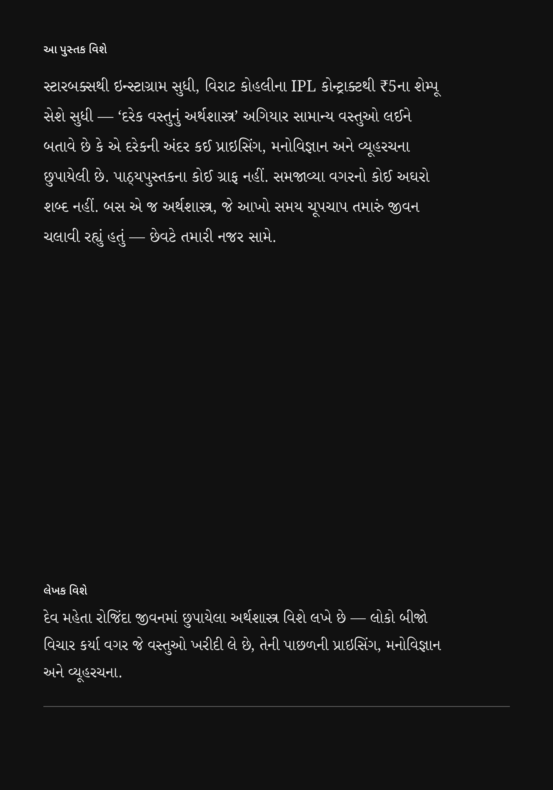

# દરેક વસ્તુનું અર્થશાસ્ત્ર

*યુવાનો માટે માર્ગદર્શિકા: દુનિયા ખરેખર કેવી રીતે ચાલે છે*

**ગુજરાતી આવૃત્તિ** · દેવ મહેતા

[🏠 મુખ્ય પૃષ્ઠ](../README.md) · [🌍 અન્ય ભાષાઓ](../README.md#-choose-your-language) · [📜 લાઇસન્સ](../LICENSE)

---

> અગિયાર રોજિંદી વસ્તુઓ — સ્ટારબક્સની કોફીથી લઈને ₹5ના શેમ્પૂ સેશે સુધી — અને એ દરેકની અંદર છુપાયેલી પ્રાઇસિંગ, મનોવિજ્ઞાન અને વ્યૂહરચના.

## 📚 અનુક્રમણિકા

- **[પ્રસ્તાવના](00-introduction.md)** — આ પુસ્તક શા માટે

1. **[સ્ટારબક્સ આટલી મોંઘી કેમ છે](01-starbucks.md)**
2. **[તમારું નેટફ્લિક્સ બિલ કેમ વધતું જ જાય છે — અને છતાં તમે કેન્સલ કેમ નથી કરતા](02-netflix.md)**
3. **[એક જ ફ્લાઇટ ટિકિટના 200 અલગ-અલગ ભાવ કેમ હોય છે](03-flight-tickets.md)**
4. **[આઇફોન ₹1,20,000નો કેમ છે — અને છતાં તમને એ કેમ જોઈએ છે](04-iphone.md)**
5. **[વિરાટ કોહલી એક IPL સીઝનમાં એટલું કેમ કમાય છે, જેટલું એક ડૉક્ટર આખી જિંદગીમાં નથી કમાતો](05-virat-kohli.md)**
6. **[ઝોમેટો તમારી બિરયાની ₹30માં કેમ પહોંચાડે છે — અને છતાં ખોટ કેમ ખાય છે](06-zomato.md)**
7. **[ભારતમાં સોનાના ભાવ ખરેખર ક્યારેય કેમ નથી ઘટતા](07-gold.md)**
8. **[UPIએ પૈસાનું અર્થશાસ્ત્ર કેવી રીતે બદલી નાખ્યું — અને દુનિયા ભારતની નકલ કેમ કરી રહી છે](08-upi.md)**
9. **[શુક્રવારે મૂવી ટિકિટ ₹1,500ની અને મંગળવારે ₹300ની કેમ હોય છે](09-movie-tickets.md)**
10. **[HUL ₹5ના સેશે વેચીને અબજો કેવી રીતે કમાય છે](10-hul-sachets.md)**
11. **[ઇન્સ્ટાગ્રામે અબજોનું અર્થતંત્ર કેવી રીતે ઊભું કર્યું — અને તમારું ધ્યાન જ પ્રોડક્ટ કેમ છે](11-instagram.md)**

- **[ઉપસંહાર](12-conclusion.md)** — દુનિયા શરૂઆતથી જ તમારી કિંમત આંકી રહી હતી
- **[નોંધ અને સ્રોત](13-notes-and-sources.md)**

---

## 👤 લેખક

**દેવ મહેતા**

*મૂળ અંગ્રેજી આવૃત્તિ પરથી અનુવાદિત.*

પાછલું કવર

 

> આ આવૃત્તિમાં કોઈ ભૂલ દેખાઈ? [ઇશ્યૂ ખોલો](https://github.com/devmehta392-prog/The-Economics-of-Everything/issues)

---

[**વાંચવાનું શરૂ કરો: પ્રસ્તાવના →**](00-introduction.md)

