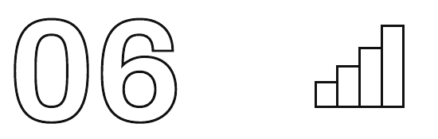

[🏠 मुख्य पृष्ठ](../README.md) › [📚 विषय-सूची](README.md) › अध्याय 6

---

# ज़ोमैटो आपकी बिरयानी ₹30 में क्यों पहुँचाता है — और फिर भी घाटे में क्यों रहता है

दोपहर का 1 बजा है। आपको भूख लगी है। खाना बनाने का मन नहीं है। आप ज़ोमैटो खोलते हैं, पाँच मिनट ब्राउज़ करते हैं, और 4 किलोमीटर दूर के एक रेस्टोरेंट से बिरयानी ऑर्डर कर देते हैं।

एक डिलीवरी पार्टनर — असली मोटरसाइकिल पर एक असली इंसान — शहर के असली ट्रैफ़िक से होते हुए आपका ऑर्डर उठाता है, वापस आता है, और आपके दरवाज़े पर गरम खाना थमा देता है। पूरी प्रक्रिया में लगभग 30 मिनट लगते हैं। आपकी डिलीवरी फ़ीस: ₹30।

भारत की न्यूनतम मज़दूरी के हिसाब से 35 मिनट की इंसानी मेहनत ₹30 से ज़्यादा की होती है। ईंधन जोड़िए। गाड़ी का मूल्यह्रास जोड़िए। सर्वर की लागत जोड़िए। कस्टमर सपोर्ट जोड़िए। वह मार्केटिंग बजट जोड़िए जिसकी वजह से आप प्लेटफ़ॉर्म पर आए। आपकी डिलीवरी की असली, सब कुछ जोड़कर लागत लगभग निश्चित रूप से ₹80–120 है।

ज़ोमैटो अपने ज़्यादातर सफ़र में मुनाफ़े में नहीं रहा। और फिर भी शेयर बाज़ार में इसकी कीमत ₹1.5 लाख करोड़ से ज़्यादा है। कैसे?

> **बीच में एक बात**
>
> *ज़ोमैटो के हेडक्वार्टर में कहीं एक स्प्रेडशीट है, जो दिखाती है कि आपकी ₹30 की डिलीवरी फ़ीस असली डिलीवरी लागत का लगभग 25–30% ही पूरा करती है। स्प्रेडशीट रंगों से सजी है। सेल लाल हैं। निवेशकों को इस स्प्रेडशीट के बारे में पता है। उन्हें इससे कोई दिक़्क़त नहीं। पूँजीवाद का यह वह हिस्सा है जिसे थोड़ा समझाना पड़ता है।*

| वित्त वर्ष | ज़ोमैटो का रेवेन्यू | शुद्ध लाभ/(घाटा) | क्या हो रहा था |
| :--- | :--- | :--- | :--- |
| FY2020 | ₹2,605 करोड़ | (₹2,386 करोड़) घाटा | तेज़ विस्तार, भारी सब्सिडी |
| FY2021 | ₹1,994 करोड़ | (₹816 करोड़) घाटा | कोविड की रुकावट, किफ़ायती संचालन |
| FY2022 | ₹4,192 करोड़ | (₹1,222 करोड़) घाटा | कोविड के बाद रिकवरी + ब्लिंकिट का अधिग्रहण |
| FY2023 | ₹7,079 करोड़ | (₹971 करोड़) घाटा | घटता घाटा, बढ़ता पैमाना |
| FY2024 | ₹14,109 करोड़ | ₹351 करोड़ मुनाफ़ा | पहला मुनाफ़े वाला साल — फ़सल काटने का दौर शुरू |

*ज़ोमैटो का घाटे से मुनाफ़े तक का सफ़र — घाटे बाज़ार पर क़ब्ज़े में निवेश थे, संचालन की नाकामी नहीं*

## ज़ोमैटो असल में क्या है (और क्या नहीं है)

ज़ोमैटो डिलीवरी कंपनी नहीं है। डोमिनोज़ पिज़्ज़ा डिलीवरी कंपनी है — प्रोडक्ट उसका अपना है, डिलीवरी स्टाफ़ उसके कर्मचारी हैं, और वह पिज़्ज़ा बेचकर मार्जिन कमाती है। पूरा संचालन एक ही बिज़नेस के भीतर ऊपर से नीचे तक जुड़ा (vertically integrated) है।

ज़ोमैटो एक टू-साइडेड प्लेटफ़ॉर्म (two-sided platform) है — एक ऐसा बाज़ार जो दो अलग-अलग समूहों (रेस्टोरेंट और ग्राहकों) के बीच जुड़ाव बनाता और बनाए रखता है, और उनके बीच लेन-देन आसान बनाकर मूल्य कमाता है। ज़ोमैटो खाना नहीं बनाता। रेस्टोरेंट का मालिक नहीं है। तकनीकी रूप से ज़्यादातर डिलीवरी पार्टनर्स को नौकरी पर नहीं रखता। डिलीवर हो रहे खाने में से कुछ भी उसका नहीं है।

ज़ोमैटो के पास जो है, वह कहीं ज़्यादा कीमती है: पूरे भारत में भूखे ग्राहकों और खाने के कारोबारों के बीच का रिश्ता और लेन-देन की पाइपलाइन — उस पैमाने पर, जिसे कोई अकेला रेस्टोरेंट या चेन ख़ुद नहीं बना सकती। FY2024 में: 800+ भारतीय शहर, 3.5 लाख+ रेस्टोरेंट पार्टनर, रोज़ लाखों ऑर्डर।

> **अवधारणा**
>
> **टू-साइडेड प्लेटफ़ॉर्म (Two-Sided Platform)**
>
> एक बिज़नेस मॉडल जो एक साथ दो अलग-अलग यूज़र समूहों की सेवा करता है, जहाँ हर समूह के लिए मूल्य दूसरे समूह के बढ़ने के साथ बढ़ता है। ज़ोमैटो को रेस्टोरेंट (प्रोडक्ट) और ग्राहक (माँग), दोनों चाहिए। ज़्यादा ग्राहक ज़्यादा रेस्टोरेंट खींचते हैं; ज़्यादा रेस्टोरेंट ग्राहकों के लिए ज़ोमैटो को ज़्यादा काम का बनाते हैं; जो और ग्राहक खींचता है। हर पक्ष दूसरे को एक तेज़ होते चक्र में मज़बूत करता है, जिसे टू-साइडेड नेटवर्क इफ़ेक्ट कहते हैं।

## नेटवर्क इफ़ेक्ट: वह ताक़त जो प्लेटफ़ॉर्म को अरबों का बना देती है

नेटवर्क इफ़ेक्ट तब होता है जब कोई प्रोडक्ट जितने ज़्यादा लोग इस्तेमाल करते हैं, उतना ज़्यादा कीमती हो जाता है — सिर्फ़ ज़्यादा लोकप्रिय नहीं, बल्कि मापने लायक आर्थिक अर्थ में सच में ज़्यादा उपयोगी। टेलीफ़ोन लीजिए: एक टेलीफ़ोन बेकार है। दो से एक कॉल हो सकती है। दस लाख टेलीफ़ोन 499 अरब अलग-अलग जुड़ाव संभव बना सकते हैं। मूल्य सीधी रेखा में नहीं, कई गुना (exponentially) बढ़ता है।

जिस शहर में ज़ोमैटो के 50 रेस्टोरेंट पार्टनर हैं, वहाँ वह थोड़ा-बहुत काम का है। 500 पार्टनर हों तो सच में काम का। 5,000 पार्टनर हों तो लगभग अनिवार्य — शहर के खाने के विकल्पों तक पहुँचने के किसी भी दूसरे तरीके से ज़्यादा व्यापक। और जैसे-जैसे ज़ोमैटो के ग्राहक बढ़ते हैं, ज़्यादा रेस्टोरेंट जुड़ने को मजबूर होते हैं। जैसे-जैसे ज़्यादा रेस्टोरेंट जुड़ते हैं, प्लेटफ़ॉर्म ग्राहकों के लिए और कीमती हो जाता है। हर पक्ष दूसरे को मज़बूत करता है।

इससे विनर-टेक्स-मोस्ट गतिशीलता बनती है: जो प्लेटफ़ॉर्म सबसे पहले क्रिटिकल मास तक पहुँचता है, उसे हटाना लगभग असंभव हो जाता है — बेहतर टेक्नोलॉजी या नियमों की वजह से नहीं, बल्कि इसलिए कि उसका नेटवर्क मूल्य शून्य से शुरू करने वाले किसी भी प्रतिद्वंद्वी से कहीं ज़्यादा होता है। ज़ोमैटो और स्विगी मिलकर भारत के संगठित फ़ूड डिलीवरी बाज़ार के 95% से ज़्यादा हिस्से पर क़ब्ज़ा रखते हैं। कई अच्छी फ़ंडिंग वाले प्रतिद्वंद्वियों — फ़ूडपांडा, उबरईट्स इंडिया, ओला फ़ूड्स — ने कोशिश की और उन्हें बाहर होना पड़ा।

फ़ूडपांडा और उबरईट्स इंडिया का बाहर होना नेटवर्क इफ़ेक्ट वाली प्रतिस्पर्धा के बारे में एक सबक़ भरी कहानी बताता है। दोनों कंपनियाँ अपने पीछे विशाल वैश्विक पैरेंट कंपनियों — क्रमशः डिलीवरी हीरो और उबर — के साथ भारतीय बाज़ार में आईं, जिनके पास बाज़ार हिस्सेदारी के लिए सालों तक घाटा झेलने के संसाधन थे। दोनों ने आक्रामक डिस्काउंट अभियान चलाए। कुछ मामलों में दोनों की टेक्नोलॉजी बेहतर भी थी। फिर भी कोई ज़ोमैटो और स्विगी को हटा नहीं सका, क्योंकि कोई मूल समस्या से पार नहीं पा सका: एक ऐसे बाज़ार में, जहाँ ज़ोमैटो के 800 शहरों में रेस्टोरेंट से रिश्ते थे और ग्राहकों में ऑर्डर करने की गहरी आदतें थीं, शून्य से शुरू करने के लिए सिर्फ़ ज़ोमैटो के मौजूदा नेटवर्क की बराबरी काफ़ी नहीं थी — उस भरोसे, परिचय और रिव्यू डेटा की भी बराबरी करनी थी जो ज़ोमैटो ने सालों में जमा किया था। आख़िरकार उबरईट्स इंडिया ने अपना भारतीय कारोबार भारी नुक़सान पर ज़ोमैटो को बेच दिया। फ़ूडपांडा ने अपना संचालन ओला को बेच दिया। विनर-टेक्स-मोस्ट बाज़ार में स्थापित नेटवर्क इफ़ेक्ट से मुकाबले की कीमत अरबों डॉलर वाली वैश्विक कंपनियों के लिए भी बहुत भारी साबित हुई।

> **आँकड़ों में**
>
> **नेटवर्क इफ़ेक्ट बनाम आम बिज़नेस का पैमाना**
>
> एक पारंपरिक बिज़नेस आकार में दोगुना होने पर मूल्य में भी लगभग दोगुना होता है। मज़बूत नेटवर्क इफ़ेक्ट वाला प्लेटफ़ॉर्म बिज़नेस अनुपात से बाहर बढ़ सकता है: यूज़र दोगुने होने पर मूल्य चार गुना हो सकता है, क्योंकि हर नया यूज़र हर मौजूदा यूज़र के लिए मूल्य जोड़ता है। मूल्य की यही अनुपात से बाहर बढ़त वजह है कि निवेशक प्लेटफ़ॉर्म के सालों के घाटे स्वीकार करते हैं — वे उस कई गुना मूल्य पर दाँव लगा रहे होते हैं जो सिर्फ़ क्रिटिकल मास से पैदा होता है।

## सब्सिडी वाली बढ़त: जान-बूझकर पैसा गँवाना एक रणनीति क्यों है

ज़ोमैटो का हर ऑर्डर पर ढाँचागत घाटा ख़राब वित्तीय प्रबंधन नहीं है। यह आधुनिक बिज़नेस के सबसे सोचे-समझे फ़ैसलों में से एक है — सब्सिडाइज़्ड ग्रोथ (subsidised growth) — प्लेटफ़ॉर्म अर्थव्यवस्था की सबसे प्रचलित प्लेबुक।

ज़ोमैटो की सबसे अहम दीर्घकालिक संपत्ति टेक्नोलॉजी या रेस्टोरेंट से रिश्ते नहीं है। वह है लाखों भारतीय उपभोक्ताओं की वह आदत, जिसके चलते भूख लगते ही वे बिना सोचे ज़ोमैटो खोल लेते हैं। आदतों के लिए समय और सकारात्मक मज़बूती चाहिए। सब्सिडी — अविश्वसनीय रूप से कम डिलीवरी फ़ीस, भारी डिस्काउंट, कूपन — वे औज़ार थे जिनसे ज़ोमैटो ने बड़े पैमाने पर आदत बनाने के लिए ज़रूरी बार-बार का सकारात्मक अनुभव पैदा किया।

सब्सिडी पर 'गँवाया' गया हर रुपया संचालन की बर्बादी नहीं है। यह ग्राहक जोड़ने और आदत बनाने में निवेश है। अगर एक ग्राहक जोड़ने में छह महीनों में कुल ₹2,000 की सब्सिडी लगती है, लेकिन वह ग्राहक अगले 10 सालों तक हर साल ₹600 का शुद्ध सकारात्मक आर्थिक योगदान देता है, तो निवेश असाधारण रिटर्न देता है। अमेज़न ने यह प्लेबुक लगभग 20 साल चलाई। उबर ने इसे दुनिया भर में चलाया। हर बड़े प्लेटफ़ॉर्म बिज़नेस ने इस रणनीति का कोई न कोई रूप इस्तेमाल किया है।

इस आर्थिक कहानी में एक और किरदार है, जिसकी चर्चा कम होती है: डिलीवरी पार्टनर। ज़ोमैटो का डिलीवरी बेड़ा ज़्यादातर गिग वर्कर्स से बना है, जो तकनीकी रूप से कर्मचारी नहीं, बल्कि स्वतंत्र ठेकेदार हैं। वे अपनी मोटरसाइकिल ख़ुद लाते हैं, ईंधन का ख़र्च ख़ुद उठाते हैं, गाड़ी का रखरखाव ख़ुद करते हैं, और हर डिलीवरी के हिसाब से कमाते हैं। 'प्लेटफ़ॉर्म' मॉडल ज़ोमैटो को डिलीवरी क्षमता को स्थिर नहीं, बल्कि परिवर्ती लागत की तरह मानने देता है — रात के खाने के पीक समय में राइडर घंटे बढ़ाना और सुस्त समय में घटाना, पूरे समय के कर्मचारियों की स्थिर लागत उठाए बिना। इसीलिए भारत में फ़ूड डिलीवरी का अर्थशास्त्र ऐसा बना है: 'लास्ट माइल' की जो लागत डिलीवरी को अविश्वसनीय रूप से सस्ता दिखाती है, उसका एक हिस्सा उन गिग वर्कर्स पर पड़ता है जिनकी प्रति घंटे कमाई, गाड़ी की लागत और ख़ाली बैठे समय को गिनने के बाद, अक्सर औपचारिक नौकरी से मिलने वाली कमाई से कम होती है।

> **बीच में एक बात**
>
> *ज़रा सोचिए, 2010 में किसी रेस्टोरेंट मालिक से कहना: '14 साल में आप अपने रेवेन्यू का 25% एक ऐसे ऐप को देंगे जो खाना नहीं बनाता, आपके शेफ़ को नौकरी नहीं देता, और आपकी रसोई का मालिक नहीं है। और आपके पास इसे जारी रखने के अलावा कोई असली विकल्प नहीं होगा।' वे आपसे जाने को कह देते। और आज हम यहीं हैं।*

## कमीशन मॉडल: रेस्टोरेंट असल में कैसे भुगतान करते हैं

जब कोई रेस्टोरेंट ज़ोमैटो से जुड़ता है, तो वह हर ऑर्डर पर 18–30% कमीशन देता है। ₹500 के ऑर्डर पर रेस्टोरेंट ज़ोमैटो को ₹90–150 देता है। हर बार। हर ऑर्डर पर। चाहे उसका मार्जिन कितना भी पतला हो। और कई रेस्टोरेंट ऐप के अंदर विज्ञापन की जगह के लिए अलग से भी पैसे देते हैं।

फिर भी ज़्यादातर रेस्टोरेंट जुड़े रहते हैं। क्यों? प्लेटफ़ॉर्म पर निर्भरता (platform dependency) — जब कोई बिज़नेस ग्राहकों तक पहुँच के लिए किसी तीसरे पक्ष के प्लेटफ़ॉर्म पर इतना निर्भर हो जाता है कि उसके बिना ठीक से काम करना लगभग असंभव हो जाता है। ज़ोमैटो के बाज़ार में दबदबे का मतलब है कि जो रेस्टोरेंट उस पर नहीं है, वह ग्राहकों के एक बहुत बड़े वर्ग के लिए अदृश्य हो जाता है। ज़ोमैटो छोड़ने का मतलब सिर्फ़ कुछ ऑर्डर गँवाना नहीं — कई इलाक़ों में इसका मतलब है ग्राहक पाने का सबसे बड़ा ज़रिया गँवा देना।

> **हक़ीक़त की जाँच**
>
> सीधी बात: अगली बार जब कोई रेस्टोरेंट मालिक डिलीवरी ऐप के अर्थशास्त्र से परेशान दिखे, तो वह बेवजह नहीं है। ज़ोमैटो का कमीशन अक्सर डिलीवरी ऑर्डर को रेस्टोरेंट के लिए आर्थिक रूप से बस किनारे का सौदा बना देता है — जबकि कमीशन ज़ोमैटो ले जाता है। उपभोक्ता को सस्ती डिलीवरी मिलती है। प्लेटफ़ॉर्म अर्थशास्त्र का फ़ायदा उठाता है। लागत का दबाव रेस्टोरेंट झेलता है। ज़ोमैटो पर मेन्यू की कीमत अक्सर रेस्टोरेंट के अंदर की कीमत से ठीक इसी कमीशन की भरपाई के लिए ज़्यादा होती है।

## ब्लिंकिट और 10 मिनट की अर्थव्यवस्था

2022 में ज़ोमैटो ने ₹4,447 करोड़ में ब्लिंकिट का अधिग्रहण किया और एक क्विक-कॉमर्स प्लेटफ़ॉर्म बन गया। दस मिनट में किराने की डिलीवरी हाइपर-लोकल डार्क स्टोर्स से होती है — 1.5–3 किमी के फ़ासले पर छोटे गोदाम जैसे स्थान, जिनमें सामान सिर्फ़ तेज़ी से ऑर्डर उठाने के लिए रखा जाता है, ग्राहकों के घूमने-देखने के लिए नहीं।

किराना ज़्यादा बार ख़रीदा जाता है — ब्लिंकिट के ऑर्डर औसतन महीने में 15–20 हो सकते हैं, जबकि ज़ोमैटो पर खाने के ऑर्डर 4–6। ज़्यादा बार ख़रीद का मतलब है ज़्यादा आदत, ज़्यादा डेटा, रेवेन्यू के ज़्यादा मौक़े। पैक्ड सामान पर मार्जिन भी रेस्टोरेंट के खाने से ज़्यादा और ज़्यादा स्थिर होता है।

डार्क स्टोर मॉडल का एक ख़ास अर्थशास्त्र है, जो पारंपरिक किराना रिटेल से बुनियादी रूप से अलग है। DMart या रिलायंस स्मार्ट जैसा पारंपरिक सुपरमार्केट 20,000–50,000 वर्ग फ़ुट के स्टोर चलाता है, जहाँ रोज़ हज़ारों ग्राहक घूमकर ख़ुद सामान चुनते हैं। स्टोर को हर प्रोडक्ट आकर्षक ढंग से सजाना, चेकआउट की कतारें संभालना, पार्किंग रखना, और ग्राहकों से मिलने वाला स्टाफ़ रखना पड़ता है। ब्लिंकिट का डार्क स्टोर 2,000–3,000 वर्ग फ़ुट का होता है, जहाँ कभी कोई ग्राहक नहीं आता, जहाँ 10–15 पिकर 3 मिनट से कम में ऑर्डर तैयार करते हैं, और जो प्रीमियम रिटेल जगहों के बजाय सस्ती औद्योगिक या अर्ध-व्यावसायिक जगहों पर होता है। प्रति वर्ग फ़ुट लागत कहीं कम होती है — और प्रति ऑर्डर रेवेन्यू तुलनीय हो सकता है, क्योंकि डिलीवरी फ़ीस और सेवा का प्रीमियम ज़रूरी लागत की भरपाई कर देते हैं।

ब्लिंकिट के प्रतिद्वंद्वियों — ज़ेप्टो, स्विगी इंस्टामार्ट, बिगबास्केट नाउ — ने इस क्षेत्र को बेहद प्रतिस्पर्धी बना दिया है। लेकिन ज़ोमैटो का दाँव यह है कि किराने की ख़रीद की बारंबारता और आदत, और साथ में ज़ोमैटो फ़ूड डिलीवरी और ब्लिंकिट ग्रॉसरी के बीच क्रॉस-सेलिंग के मौक़े, मिले-जुले बिज़नेस को दोनों में से किसी एक से कहीं ज़्यादा कीमती बनाते हैं। जो उपभोक्ता हर हफ़्ते तीन-तीन बार ज़ोमैटो पर खाना और ब्लिंकिट पर किराना मँगाता है, वह किसी एक सेवा का इस्तेमाल करने वाले उपभोक्ता से ज़्यादा डेटा, ज़्यादा जुड़ाव और कमाई के ज़्यादा मौक़े पैदा करता है — और ज़ोमैटो इकोसिस्टम में वह जितनी सेवाएँ इस्तेमाल करता है, किसी प्रतिद्वंद्वी पर जाने की उसकी स्विचिंग लागत उतनी बढ़ती जाती है।

## पैसा फूँकने से कमाने तक: फ़सल काटने का दौर

FY2024 में ज़ोमैटो ने अपना अब तक का पहला शुद्ध मुनाफ़ा दर्ज किया: ₹351 करोड़। ऐसा इसलिए नहीं हुआ कि बिज़नेस मॉडल बदल गया। निवेश का दौर फ़सल काटने (harvest) के दौर में बदल रहा था। एक बार बाज़ार में दबदबा हासिल होने के बाद सब्सिडी धीरे-धीरे घटाई गई, रेस्टोरेंट से कमीशन दरें बनाए रखी गईं, गोल्ड सब्सक्रिप्शन ने अनुमान लगाने लायक नियमित रेवेन्यू दिया, और उसी यूज़र बेस पर नई सेवाएँ शुरू हुईं।

ज़ोमैटो गोल्ड — मुफ़्त डिलीवरी और रेस्टोरेंट पर छूट देने वाला पेड मेंबरशिप प्रोग्राम — फ़सल काटने वाले दौर की रणनीति का बेहतरीन उदाहरण है। ज़ोमैटो के शुरुआती विकास में डिलीवरी सब्सिडी डिफ़ॉल्ट रूप से सबको दी गई, जिससे लाखों यूज़र सस्ती डिलीवरी को आम बात मानने लगे। फ़सल काटने के दौर में वे सब्सिडी एक पेड मेंबरशिप में समेट दी गईं: हर महीने ₹299 में आपको वे डिलीवरी फ़ायदे मिलते हैं जो पहले मुफ़्त मिलते थे। जो सदस्य जुड़ते हैं, वे ख़ुद ही साबित कर देते हैं कि वे सबसे ज़्यादा बार ऑर्डर करने वाले, सबसे कीमती यूज़र हैं — ठीक वही वर्ग जिसे ज़ोमैटो हर कीमत पर बनाए रखना चाहता है। मेंबरशिप फ़ीस अनुमान लगाने लायक नियमित रेवेन्यू देती है और साथ ही सब्सक्राइबर वर्ग के भीतर सब्सिडी वाली डिलीवरी के अर्थशास्त्र को टिकाऊ बनाती है।

घाटे कभी घाटे थे ही नहीं। वे बाज़ार पर क़ब्ज़े के लिए सही समय पर किए गए रणनीतिक निवेश थे। अब उनका रिटर्न वसूला जा रहा है — ठीक वैसे ही जैसा मूल रणनीति में सोचा गया था।

ज़ोमैटो ने शुरुआत घाटे पर बिरयानी पहुँचाकर की थी। अब वह ऐसा इंफ़्रास्ट्रक्चर बना रहा है जिसके बिना काम करने की कल्पना करना रेस्टोरेंट, ग्राहकों और किराना सप्लाई चेन के लिए असाधारण रूप से मुश्किल हो जाए। असली बिज़नेस यही है।

> **निष्कर्ष**
>
> आपके लिए इसका मतलब: जब भी आप किसी ऐप पर भारी डिस्काउंट वाली सेवा इस्तेमाल करें, तो पूछिए: इसकी सब्सिडी कौन दे रहा है? जवाब लगभग हमेशा होता है — 'निवेशक'। फिर पूछिए: डिस्काउंट ख़त्म होने पर भी क्या मैं टिका रहूँगा? ज़ोमैटो जैसी कंपनियाँ दाँव लगा रही हैं कि आप टिके रहेंगे — क्योंकि आदत और सुविधा डिस्काउंट से ज़्यादा टिकाऊ होती हैं। आम तौर पर वे सही होती हैं। किसी भी ऐप के साथ रिश्ते का सबसे महँगा पल वह होता है जब डिस्काउंट रुकते हैं — क्योंकि तभी पता चलता है कि प्रोडक्ट ख़ुद कभी पूरी कीमत के लायक था भी या नहीं।

---

### ✅ झटपट जाँच

*देखते हैं, आपने सच में पढ़ा या बस टेबल निहारते रहे...*

**1. ज़ोमैटो को डिलीवरी कंपनी के बजाय 'टू-साइडेड प्लेटफ़ॉर्म' कहना ज़्यादा सही क्यों है?**

- **A** — ज़ोमैटो एक साथ फ़ूड डिलीवरी और ब्लिंकिट ग्रॉसरी चलाता है
- **B** — ज़ोमैटो दो अलग-अलग समूहों (रेस्टोरेंट + ग्राहक) को जोड़कर और उनके आपसी लेन-देन से कमाकर मूल्य पैदा करता है
- **C** — ज़ोमैटो की सह-स्थापना दो लोगों ने की थी जिन्होंने बिज़नेस के दोनों पक्ष बनाए
- **D** — ऐप के iOS और एंड्रॉयड दोनों वर्ज़न अलग प्लेटफ़ॉर्म की तरह चलते हैं

**2. ज़ोमैटो के मामले में 'नेटवर्क इफ़ेक्ट' का मतलब है:**

- **A** — ऐप तेज़ WiFi कनेक्शन पर बेहतर चलता है
- **B** — लेन-देन की मात्रा बढ़ने के साथ प्लेटफ़ॉर्म हर लेन-देन पर ज़्यादा कमाता है
- **C** — ज़्यादा राइडर जुड़ने से ज़ोमैटो का डिलीवरी नेटवर्क तेज़ होता है
- **D** — जितने ज़्यादा यूज़र (रेस्टोरेंट और ग्राहक) जुड़ते हैं, प्रोडक्ट हर यूज़र के लिए उतना ज़्यादा कीमती होता जाता है

**3. ज़ोमैटो की 'सब्सिडी वाली बढ़त' रणनीति का मतलब है कि शुरुआती सालों के घाटे थे:**

- **A** — संस्थापक टीम के ख़राब वित्तीय प्रबंधन की वजह से
- **B** — रेस्टोरेंट पार्टनर्स द्वारा आगे बढ़ाई गई सामग्री की ऊँची लागत की वजह से
- **C** — कमाई शुरू करने से पहले ग्राहकों की आदतें और बाज़ार में दबदबा बनाने के लिए सोचे-समझे निवेश
- **D** — डिलीवरी फ़ीस पर सीमा लगाने वाले सरकारी नियमों की मजबूरी

**4. 'प्लेटफ़ॉर्म पर निर्भरता' समझाती है कि भारी कमीशन के बावजूद रेस्टोरेंट ज़ोमैटो पर क्यों टिके रहते हैं, क्योंकि:**

- **A** — ज़ोमैटो के पास अपने कई रेस्टोरेंट पार्टनर्स में हिस्सेदारी है
- **B** — छोड़ने पर वे ग्राहकों के एक बहुत बड़े वर्ग के लिए अदृश्य हो जाएँगे, जिसे वे गँवा नहीं सकते
- **C** — सरकारी अनुबंधों के मुताबिक़ पंजीकृत रेस्टोरेंट को प्रमाणित फ़ूड प्लेटफ़ॉर्म पर लिस्ट होना ज़रूरी है
- **D** — ज़ोमैटो रेस्टोरेंट को सब्सिडी वाली पैकेजिंग और कोल्ड-चेन स्टोरेज देता है

<b>जवाब देखें</b>

1. **B** — ज़ोमैटो दो अलग-अलग समूहों (रेस्टोरेंट + ग्राहक) को जोड़कर और उनके आपसी लेन-देन से कमाकर मूल्य पैदा करता है
2. **D** — जितने ज़्यादा यूज़र (रेस्टोरेंट और ग्राहक) जुड़ते हैं, प्रोडक्ट हर यूज़र के लिए उतना ज़्यादा कीमती होता जाता है
3. **C** — कमाई शुरू करने से पहले ग्राहकों की आदतें और बाज़ार में दबदबा बनाने के लिए सोचे-समझे निवेश
4. **B** — छोड़ने पर वे ग्राहकों के एक बहुत बड़े वर्ग के लिए अदृश्य हो जाएँगे, जिसे वे गँवा नहीं सकते

---

[← अध्याय 5](05-virat-kohli.md) · [📚 विषय-सूची](README.md) · [आगे: अध्याय 7 →](07-gold.md)

