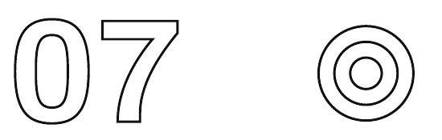

[🏠 मुख्य पृष्ठ](../README.md) › [📚 विषय-सूची](README.md) › अध्याय 7

---

# भारत में सोने की कीमतें असल में कभी गिरती क्यों नहीं

अर्थशास्त्र की हर पाठ्यपुस्तक पूरे आत्मविश्वास से एक बुनियादी सिद्धांत बताती है: जब किसी चीज़ की कीमत बढ़ती है, तो लोग उसे कम ख़रीदते हैं। माँग का नियम। माँग वक्र नीचे की ओर ढलता है। इसे लगभग प्रकृति के नियम की तरह पेश किया जाता है।

भारत में सोना इस नियम को लगातार, पूरी तरह, और ऐसी गहरी ढाँचागत वजहों से तोड़ता है कि भारतीय अर्थशास्त्र पर किसी भी ईमानदार किताब में इसका अपना एक अध्याय होना चाहिए।

2024 में सोना ₹74,000 प्रति 10 ग्राम पार कर गया। चार दशकों में भारत की उपभोक्ता महँगाई हर साल लगभग 6–7% रही। अगर सोना बस आम महँगाई के साथ चलता, तो आज उसकी कीमत लगभग ₹18,000 प्रति 10 ग्राम होती। कीमत है ₹74,000। और माँग पहले कभी इतनी ऊँची नहीं थी।

भारतीय परिवारों के पास मिलाकर अनुमानित 25,000 टन सोना है, जिसकी कीमत लगभग ₹150 लाख करोड़ है। धरती की किसी भी सरकार के आधिकारिक राष्ट्रीय भंडार से ज़्यादा सोना भारतीय घरों, मंदिरों और बैंक लॉकरों में रखा है।

> **बीच में एक बात**
>
> *आपकी पड़ोस वाली आंटी के गोदरेज लॉकर में कुछ छोटे देशों के आधिकारिक भंडार से ज़्यादा सोना हो सकता है। उन्हें यह पता है। असली बात यही है। इस एक ख़ास मामले में, आंटी के लॉकर का अर्थशास्त्र और किसी राष्ट्रीय ख़ज़ाने का अर्थशास्त्र ढाँचागत रूप से बिल्कुल एक जैसा है।*

| साल | सोने की कीमत (₹/10 ग्राम) | भारत का आयात (टन) | वैश्विक हिस्सा | क्या हो रहा था |
| :--- | :--- | :--- | :--- | :--- |
| 2000 | ₹4,400 | 715 | ~22% | उदारीकरण से पहले वाले ख़रीद के तरीके |
| 2010 | ₹19,000 | 958 | ~27% | वित्तीय संकट के बाद दुनिया भर में सोने की होड़ |
| 2016 | ₹27,000 | 666 | ~21% | सामान्य आधार वर्ष |
| 2020 | ₹48,000 | 446 | ~16% | कोविड से शादियाँ घटीं; माँग कम |
| 2022 | ₹52,000 | 706 | ~22% | कोविड के बाद शादियों के मौसम की वापसी |
| 2024 | ₹74,000+ | 800+ | ~24% | रिकॉर्ड कीमतें, रिकॉर्ड माँग |

*2016–2024 के बीच सोने की कीमतें तीन गुना हो गईं — और माँग भी उनके साथ बढ़ी। आम माँग वक्र यहाँ लागू नहीं होते।*

## 5,000 साल का वह संदर्भ जो अर्थशास्त्र की कोई पाठ्यपुस्तक नहीं बताती

भारत के दर्ज इतिहास के ज़्यादातर हिस्से में न बैंक थे, न शेयर बाज़ार, न सरकारी बचत बॉन्ड, न बीमा, न औपचारिक सामाजिक सुरक्षा। अगर किसी किसान की फ़सल अच्छी रही और वह उस मूल्य को बचाना चाहता, तो विकल्प सच में सीमित थे: अनाज जमा करना (जो ख़राब हो जाता है), ज़मीन में लगाना (जिसे जल्दी बेचा नहीं जा सकता और जिस पर विवाद हो सकता है), या सोना ख़रीदना।

और सदियों की असाधारण उथल-पुथल में — मुग़ल सत्ता के बदलाव, यूरोपीय औपनिवेशिक लूट, बंगाल का अकाल, 1947 का विभाजन, कई मुद्रा सुधार, आपातकाल — सोने ने बार-बार अपनी बात साबित की। काग़ज़ी मुद्रा जारी हुई और उसका मूल्य गिरा। ज़मीन ज़ब्त हो सकती थी या पीढ़ियों तक विवाद में फँसी रह सकती थी। लेकिन 1947 में जिस महिला के पास सोना था, वह विभाजन के दौरान अपने परिवार की दौलत सुरक्षित लिए पंजाब की सीमा पार कर सकती थी — एक ऐसे रूप में, जिसे कोई सत्ता आसानी से न ट्रैक कर सकती थी, न ज़ब्त कर सकती थी, न रातों-रात महँगाई से गला सकती थी।

जब आप म्यूचुअल फ़ंड ख़रीदते हैं, तो आप एक फ़ंड मैनेजर, एक नियामक प्रणाली, एक शेयर बाज़ार, और उन वित्तीय संस्थाओं के लगातार चलते रहने पर भरोसा करते हैं जो भारत में ज़्यादा से ज़्यादा कुछ दशकों से मौजूद हैं। जब एक भारतीय महिला सोने के गहने ख़रीदती है, तो वह उस चीज़ पर भरोसा कर रही होती है जिसने 50 पीढ़ियों और कई सभ्यतागत उथल-पुथल के बीच अपनी क्रय शक्ति बनाए रखी है।

> **अवधारणा**
>
> **कीमत के प्रति बेलोचदार माँग (Price Inelastic Demand)**
>
> माँग तब बेलोचदार होती है जब कीमत बढ़ने पर वह ज़्यादा नहीं घटती — आम तौर पर इसलिए कि प्रोडक्ट किसी ज़रूरी या गहराई से जमी ज़रूरत को पूरा करता है। भारत में सोना कीमत के प्रति चरम बेलोच दिखाता है: ₹74,000 प्रति 10 ग्राम पर भी शादियों की माँग ठोस रूप से नहीं घटती, क्योंकि शादी में सोना देने का सामाजिक और रीति-रिवाज़ वाला दायित्व बाज़ार की कीमतों से मोल-भाव नहीं करता। जब कोई चीज़ बेलोचदार होती है, तो कीमत बढ़ने से माँग ख़त्म नहीं होती — मुख्य रूप से बस ख़रीदार की जेब को चोट लगती है।

## शादी की अर्थव्यवस्था: जहाँ कीमत लगभग बेमानी है

भारत में हर साल अनुमानित 1 करोड़ शादियाँ होती हैं। भारतीय शादी में सोना वैकल्पिक नहीं है। यह सामाजिक रूप से अनिवार्य है — धार्मिक रीति-रिवाज़, पारिवारिक सम्मान, क़ानूनी रूप से मान्य स्त्रीधन की अवधारणा (भारतीय क़ानून के तहत दुल्हन की निजी संपत्ति), और उन सामाजिक अपेक्षाओं में रचा-बसा, जिन्होंने सदियों से भारतीय विवाह को आकार दिया है।

शादी में दिया गया सोना सिर्फ़ गहना नहीं है। यह बड़े परिवार, समाज के बुज़ुर्गों और बाद में शादी की चर्चा करने वाले हर व्यक्ति के सामने दिया गया एक सार्वजनिक बयान है। अगर सोने की कीमत दोगुनी हो जाए, तब भी भारतीय शादियाँ होती हैं। सोना देने का सामाजिक दायित्व कमज़ोर नहीं पड़ता। परिवार ज़्यादा ज़ोर लगाकर बचत करते हैं या मौजूदा संपत्तियों पर कर्ज़ लेते हैं — लेकिन वे सोने की जगह फ़िक्स्ड डिपॉज़िट का सर्टिफ़िकेट नहीं रखते।

> **बीच में एक बात**
>
> *भारतीय शादी में 'सोना ठीक-ठाक था' वाक्य परिवार के पूरे वित्तीय सफ़र की तीखी आलोचना है। 'सोना बहुत अच्छा था' वाक्य पीढ़ियों तक पक्की जानकारी की तरह आगे बढ़ता है। यह भौतिकवाद नहीं है। यह एक बेहद कारगर सामाजिक क्रेडिट स्कोरिंग प्रणाली है, जो संयोग से गहनों की शक्ल में पहनी जाती है।*

> **आँकड़ों में**
>
> **शादियों के सोने की अर्थव्यवस्था**
>
> हर साल 1 करोड़ शादियाँ × कम से कम औसत 50 ग्राम = सिर्फ़ शादियों से 500 टन सोने की माँग — भारत के कुल सालाना सोना आयात के आधे से ज़्यादा। उत्तर और दक्षिण भारत की महँगी शादियों में हर परिवार से 500–2,000 ग्राम तक हो सकता है। शादियों के सोने की माँग असल में सालाना सोने की खपत के नीचे एक न्यूनतम फ़र्श है, जिसे कीमतों में बढ़ोतरी आसानी से नहीं तोड़ सकती।

## सोना: भारत की अनौपचारिक बीमा व्यवस्था

ग्रामीण और अर्ध-शहरी इलाक़ों के करोड़ों भारतीयों के लिए सोना वित्तीय विकल्पों में से एक चुनाव नहीं था — आपात नक़दी, मूल्य संजोने और अनौपचारिक कर्ज़ के लिए वही इकलौता सुलभ विकल्प था।

जब किसी किसान की फ़सल बर्बाद हो जाती और परिवार को तुरंत नक़दी चाहिए होती, तो वे म्यूचुअल फ़ंड की यूनिट नहीं बेच सकते थे या क्रेडिट लाइन से पैसा नहीं निकाल सकते थे। वे सोना बेचते थे — स्थानीय सुनार की दुकान पर, तुरंत, ऐसी कीमत पर जिसे हर कोई समझता है, बिना काग़ज़ी कार्रवाई, बिना क्रेडिट स्कोर, बिना इंतज़ार। मुथूट फ़ाइनेंस और मणप्पुरम — दो विशाल लिस्टेड कंपनियाँ — पूरी तरह इसी गतिशीलता की वजह से मौजूद हैं। उनका होना और उनका आकार इस बात की गवाही है कि करोड़ों भारतीय परिवारों के वित्तीय तर्क में सोने का गिरवी (collateral) के रूप में इस्तेमाल कितनी गहराई तक बैठा है।

मुथूट फ़ाइनेंस के आँकड़े इस घटना को बेहद साफ़ दिखाते हैं। FY2024 तक मुथूट फ़ाइनेंस की गोल्ड लोन संपत्ति लगभग ₹85,000 करोड़ थी — यानी भारतीय परिवारों ने नक़द कर्ज़ के लिए ₹85,000 करोड़ का सोना गिरवी रखा था। मणप्पुरम इसमें ₹22,000 करोड़ और जोड़ता है। सिर्फ़ ये दो कंपनियाँ मिलकर लाखों भारतीय परिवारों को ₹1 लाख करोड़ से ज़्यादा का सोने पर आधारित कर्ज़ दे चुकी हैं — ऐसे परिवार जिन्हें किसी भी बैंक लोन प्रक्रिया से तेज़ नक़दी चाहिए थी। और इनके पीछे ज़िले और तालुका स्तर पर काम करने वाली सैकड़ों स्थानीय और क्षेत्रीय गोल्ड लोन कंपनियाँ हैं।

गोल्ड लोन का अर्थशास्त्र भारत में वित्तीय पहुँच के बारे में कुछ बुनियादी बात बताता है। बैंक से औपचारिक पर्सनल लोन के लिए क्रेडिट स्कोर, नौकरी के काग़ज़, आमदनी का सबूत, शायद एक गारंटर, और कई दिनों से लेकर हफ़्तों तक का प्रोसेसिंग समय चाहिए। गोल्ड लोन के लिए एक ही चीज़ चाहिए: असली सोना। आप अंदर जाते हैं, वे उसे तौलते हैं, और एक घंटे के भीतर आपको उसकी बाज़ार कीमत का 75% नक़द मिल जाता है। बैंकों का पूरा औपचारिक कर्ज़-आकलन तंत्र — क्रेडिट हिस्ट्री, आमदनी की स्थिरता, नौकरी की जाँच — एक ऐसी संपत्ति से बदल जाता है जो हर जगह आसानी से नक़दी में बदलती है, हर जगह कीमती मानी जाती है, और जो आपके पास पहले से है। उन आबादियों के लिए जो ऐतिहासिक रूप से औपचारिक कर्ज़ से बाहर रही हैं — छोटे किसान, दिहाड़ी मज़दूर, रेहड़ी-पटरी वाले, घरेलू कामगार — सोने पर आधारित कर्ज़ कोई घटिया प्रोडक्ट नहीं है। यही इकलौता संभव प्रोडक्ट है, और मुथूट या मणप्पुरम के इसे औपचारिक रूप देने से सदियों पहले से यह यही काम करता आ रहा है।

## महँगाई से बचाव: समझदार निवेशक भी सोना क्यों ख़रीदते हैं

पिछले 40 सालों में भारतीय रुपये ने अपनी क्रय शक्ति का लगभग 85% गँवा दिया है। सोने को महँगाई से फुलाया नहीं जा सकता — धरती पर उसकी कुल मात्रा भूगर्भ तय करता है, सरकारी नीति नहीं। दुनिया भर का सालाना सोना खनन कुल आपूर्ति में हर साल सिर्फ़ 1.5–2% जोड़ता है — ज़्यादातर बड़ी अर्थव्यवस्थाओं में मुद्रा आपूर्ति की बढ़त से कहीं कम।

रुपये के अवमूल्यन का पहलू भी है। अंतरराष्ट्रीय स्तर पर सोने की कीमत अमेरिकी डॉलर में तय होती है। 2003 में लगभग ₹44 प्रति डॉलर से रुपया 2024 में लगभग ₹83 तक गिर गया। अगर अंतरराष्ट्रीय सोने की कीमतें बिल्कुल स्थिर भी रहतीं, तब भी सिर्फ़ मुद्रा के अवमूल्यन से रुपये में भारतीय सोने की कीमतें 47% बढ़ जातीं।

महँगाई से बचाव वाले तर्क को ठोस शब्दों में रखें: जिस परिवार ने 2000 में लगभग ₹4,400 में 10 ग्राम सोना ख़रीदा, उसके पास 2024 में लगभग ₹74,000 की संपत्ति है — 24 साल में लगभग 16.8 गुना रिटर्न, यानी हर साल लगभग 11.4% चक्रवृद्धि। इसी दौरान भारत के सेंसेक्स ने लगभग 13–15% का सालाना चक्रवृद्धि रिटर्न दिया। इस तुलना में सोना शेयरों से पीछे रहा — लेकिन कहीं कम उतार-चढ़ाव के साथ, बिना मैनेजमेंट फ़ीस, बिना प्रतिपक्ष जोखिम (counterparty risk), और बिना डीमैट खाते, ब्रोकर या 'सोना मूल्य बचाए रखता है' से आगे किसी वित्तीय समझ की ज़रूरत के। जिन परिवारों ने यह सोना ख़रीदा — जिनमें से कई का शेयर बाज़ार से कोई लेना-देना नहीं था — उनके लिए 11.4% का चक्रवृद्धि रिटर्न न सिर्फ़ सम्मानजनक था, बल्कि उनकी परिस्थितियों और जानकारी को देखते हुए शायद उनके पास मौजूद सबसे अच्छा वित्तीय फ़ैसला था।

यही वह अहम बारीकी है, जिसे शहरी, वित्तीय रूप से जानकार टिप्पणीकार अक्सर सोने से भारत के लगाव की आलोचना करते समय भूल जाते हैं। विकल्प यह नहीं था कि 'SIP से डाइवर्सिफ़ाइड इक्विटी म्यूचुअल फ़ंड ख़रीदो।' करोड़ों परिवारों के लिए विकल्प था 'पैसा सेविंग्स अकाउंट में रखो, जिस पर महँगाई से पहले 4% मिलता है,' 'घर में नक़द रखो,' या 'ज़मीन ख़रीदो, उसकी सारी नक़दी की दिक़्क़त और क़ानूनी उलझनों के साथ।' इन असली विकल्पों के मुकाबले आँकें — किसी सैद्धांतिक सबसे अच्छे विकल्प के मुकाबले नहीं — तो सोने का रिकॉर्ड सच में मज़बूत है।

## सरकारी नीति 5,000 साल की आदत को क्यों नहीं हरा सकती

भारत सरकार ने सोने का आयात घटाने की बार-बार कोशिश की है: आयात शुल्क 15% तक बढ़ाया, गोल्ड मॉनेटाइज़ेशन स्कीम लाई जो बैंक में असली सोना जमा करने पर ब्याज देती है, सॉवरेन गोल्ड बॉन्ड लाए जो सालाना 2.5% ब्याज देते हैं। इनमें से किसी ने भी किसी लंबे समय तक असली सोने की माँग में ठोस कमी नहीं की।

गोल्ड मॉनेटाइज़ेशन स्कीम इसलिए नाकाम रही क्योंकि वह समझ ही नहीं पाई कि भारतीय असली सोना क्यों रखते हैं। उसने परिवारों से कहा कि काग़ज़ी ब्याज के बदले अपना भौतिक क़ब्ज़ा छोड़ दें — अपने गहने बैंक को दे दें। लेकिन भौतिक क़ब्ज़ा सोने के बीमा वाले मूल्य से अलग नहीं किया जा सकता। भारतीय यादों में बैंक डूबने की घटनाएँ हुई हैं। आपके हाथ में रखा असली सोना नहीं डूब सकता।

सॉवरेन गोल्ड बॉन्ड सच में बेहतरीन वित्तीय प्रोडक्ट हैं। लेकिन वे शादी में सोने के गहनों की जगह नहीं ले सकते। किसी भी दुल्हन का परिवार 200 ग्राम के सॉवरेन गोल्ड बॉन्ड सर्टिफ़िकेट पेश करके वह सामाजिक वज़न नहीं पा सकता जो दुल्हन के पहने 200 ग्राम असली गहनों का होता है।

व्यापक अर्थशास्त्र (macroeconomics) की नज़र से सोने की माँग पर सरकार की झुंझलाहट समझ में आती है। भारत हर साल लगभग 800 टन सोना आयात करता है, जिसकी कीमत लगभग 40–45 अरब डॉलर की विदेशी मुद्रा है। कच्चे तेल के बाद यह आयात की दूसरी सबसे बड़ी श्रेणी है। सोने के आयात का बिल भारत के चालू खाता घाटे (current account deficit) में ठोस योगदान देता है — यानी भारत निर्यात से जो कमाता है और आयात पर जो ख़र्च करता है, उसके बीच का फ़ासला। जो देश 45 अरब डॉलर की एक ऐसी धातु आयात करता है जो न औद्योगिक उत्पादन देती है, न रोज़गार, न टेक्नोलॉजी का हस्तांतरण, वह व्यापक अर्थशास्त्र की नज़र से एक ऐसे 'मूल्य संजोने के साधन' के बदले पूँजी बाहर भेज रहा है, जिसका काम सैद्धांतिक रूप से घरेलू वित्तीय साधन भी कर सकते थे।

फिर भी इस माँग को मोड़ने की सरकार की हर कोशिश थोड़े-बहुत असर से आगे नहीं बढ़ पाई। वजह ढाँचागत है: भारत में सोने का मूल्य-प्रस्ताव मुख्य रूप से वित्तीय नहीं है। वह सामाजिक, सांस्कृतिक, ऐतिहासिक और मनोवैज्ञानिक है। आप 5,000 साल पुरानी दौलत बचाने की टेक्नोलॉजी और उसमें रची-बसी सांस्कृतिक परंपराओं को एक नीति सर्कुलर और 2.5% ब्याज से नहीं बदल सकते। जो सरकार सोने के पूरे मूल्य-प्रस्ताव — ले जाने में आसान, निजी, हर जगह आसानी से नक़दी में बदलने वाला, सामाजिक रूप से अर्थपूर्ण, इतिहास में परखा हुआ, शून्य प्रतिपक्ष जोखिम — की बराबरी किसी घरेलू साधन से करने का तरीका खोज लेगी, वह वित्तीय इतिहास में सच में कुछ अभूतपूर्व कर दिखाएगी।

भारत में सोना तर्कहीन नहीं है। यह एक ऐसी सभ्यता की जमा हुई वित्तीय समझ है, जिसने सदियों के कड़वे अनुभव से उस चीज़ पर भरोसा करना सीखा जिसे कोई सरकार रातों-रात न छाप सकती है, न उसका मूल्य गिरा सकती है, न ज़ब्त कर सकती है।

> **निष्कर्ष**
>
> आपके लिए इसका मतलब: सोना हर कीमत पर आपके लिए अपने आप अच्छा निवेश नहीं है। उससे कोई आमदनी नहीं होती (न डिविडेंड, न ब्याज), ख़रीदते समय बनवाई (making charges) लगती है, और असली ब्याज दरें बढ़ने के दौर में वह काफ़ी पीछे रह सकता है। लेकिन अपने माता-पिता के उससे लगाव को अंधविश्वास कहकर ख़ारिज करने से पहले समझिए कि उनके ऐतिहासिक और आर्थिक संदर्भ में वह उनकी कौन-सी समस्या हल कर रहा था। गहरी सीख: किसी भी आर्थिक व्यवहार को 'तर्कहीन' कहने से पहले पूछिए कि वह मूल रूप से किस तर्कसंगत समस्या को हल करने के लिए बना था।

---

### ✅ झटपट जाँच

*देखते हैं, आपने सच में पढ़ा या बस टेबल निहारते रहे...*

**1. भारत में सोने की माँग को मुख्य रूप से 'कीमत के प्रति बेलोचदार' क्यों कहा जाता है:**

- **A** — RBI सोने की घरेलू कीमतें तय करता है और उन्हें गिरने से रोकता है
- **B** — भारतीय परिवारों को आम तौर पर सोने की कीमतों के उतार-चढ़ाव की जानकारी नहीं होती
- **C** — कीमतें काफ़ी बढ़ने पर भी सांस्कृतिक और शादियों की माँग मज़बूती से बनी रहती है
- **D** — भारत इतना घरेलू सोना पैदा करता है कि कीमतें स्वीकार्य स्तर पर स्थिर रहती हैं

**2. गोल्ड मॉनेटाइज़ेशन स्कीम मुख्य रूप से इसलिए नाकाम रही क्योंकि:**

- **A** — उसमें मिलने वाली ब्याज दर तुलनीय फ़िक्स्ड डिपॉज़िट दरों से कम थी
- **B** — उसमें भौतिक क़ब्ज़ा छोड़ना पड़ता था, जिससे वही सुरक्षा का फ़ायदा ख़त्म हो जाता है जिसके लिए लोग सोना रखते हैं
- **C** — स्कीम में विदेशी सोना स्वीकार नहीं किया जाता था
- **D** — SEBI ने इसे प्रतिभूति बाज़ार के टकराव के रूप में रोक दिया

**3. अंतरराष्ट्रीय सोने की कीमतें स्थिर रहने पर भी रुपये में भारतीय सोने की कीमतें बढ़ सकती हैं, क्योंकि:**

- **A** — RBI हर साल अंतरराष्ट्रीय कीमतों के ऊपर एक घरेलू गोल्ड प्रीमियम लगाता है
- **B** — कीमतें चाहे जो हों, भारत हर साल सोने पर आयात शुल्क बढ़ाता है
- **C** — दुनिया भर में सोने की कीमत USD में तय होती है — रुपये का अवमूल्यन रुपये में लागत अपने आप बढ़ा देता है
- **D** — भारत का घरेलू सोना खनन घट रहा है, जिससे आपूर्ति में कमी आ रही है

**4. भारतीय परिवारों ने ऐतिहासिक रूप से वित्तीय साधनों के मुकाबले सोने पर मुख्य रूप से इसलिए भरोसा किया क्योंकि:**

- **A** — सोने की गारंटी ब्रिटिश औपनिवेशिक सरकार ने दी थी, जो स्वतंत्र भारत में भी जारी रही
- **B** — बचत जमाओं पर ब्याज दरें असल में लगातार नकारात्मक रहीं
- **C** — 1947 से पहले भारत में औपचारिक बैंकिंग व्यवस्था मौजूद ही नहीं थी
- **D** — सदियों की उथल-पुथल में, जब काग़ज़ी मुद्रा और दूसरी संपत्तियाँ बार-बार नाकाम रहीं, सोने ने अपना मूल्य बनाए रखा

<b>जवाब देखें</b>

1. **C** — कीमतें काफ़ी बढ़ने पर भी सांस्कृतिक और शादियों की माँग मज़बूती से बनी रहती है
2. **B** — उसमें भौतिक क़ब्ज़ा छोड़ना पड़ता था, जिससे वही सुरक्षा का फ़ायदा ख़त्म हो जाता है जिसके लिए लोग सोना रखते हैं
3. **C** — दुनिया भर में सोने की कीमत USD में तय होती है — रुपये का अवमूल्यन रुपये में लागत अपने आप बढ़ा देता है
4. **D** — सदियों की उथल-पुथल में, जब काग़ज़ी मुद्रा और दूसरी संपत्तियाँ बार-बार नाकाम रहीं, सोने ने अपना मूल्य बनाए रखा

---

[← अध्याय 6](06-zomato.md) · [📚 विषय-सूची](README.md) · [आगे: अध्याय 8 →](08-upi.md)

