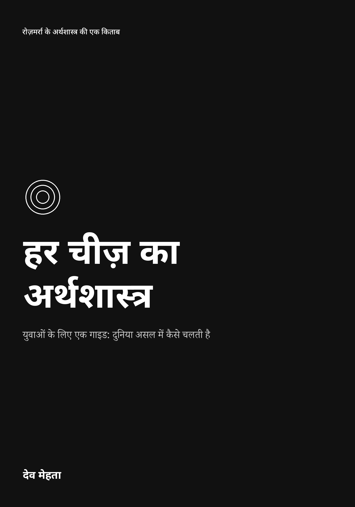
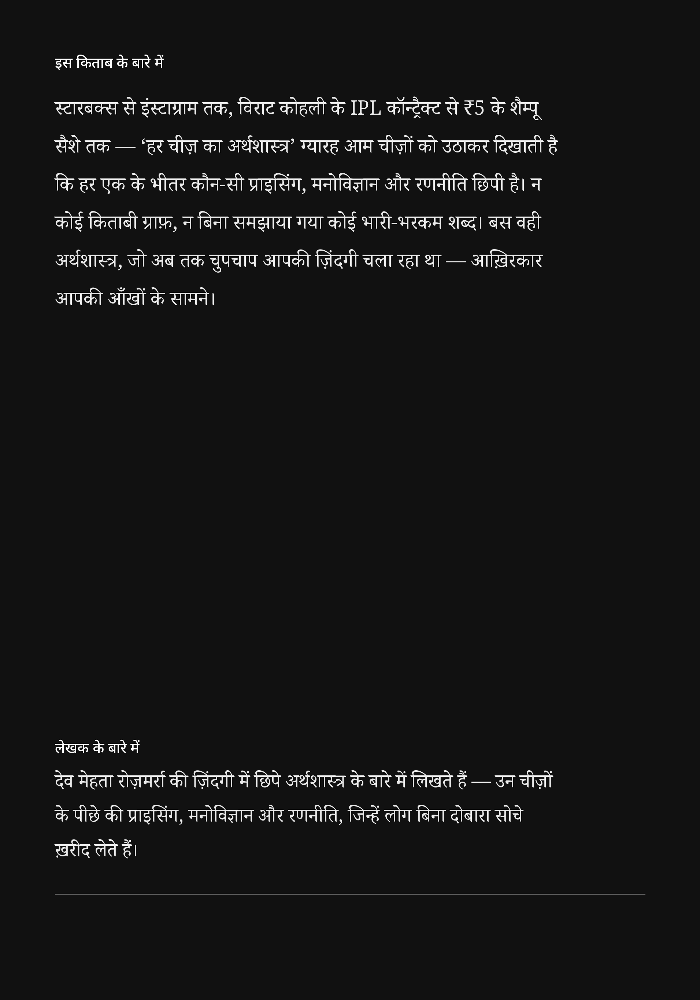

# हर चीज़ का अर्थशास्त्र

*युवाओं के लिए एक गाइड: दुनिया असल में कैसे चलती है*

**हिन्दी संस्करण** · देव मेहता

[🏠 मुख्य पृष्ठ](../README.md) · [🌍 अन्य भाषाएँ](../README.md#-choose-your-language) · [📜 लाइसेंस](../LICENSE)

---

> ग्यारह रोज़मर्रा की चीज़ें — स्टारबक्स की कॉफ़ी से लेकर ₹5 के शैम्पू सैशे तक — और हर एक के भीतर छिपी प्राइसिंग, मनोविज्ञान और रणनीति।

## 📚 विषय-सूची

- **[भूमिका](00-introduction.md)** — यह किताब क्यों लिखी गई

1. **[स्टारबक्स इतनी महँगी क्यों है](01-starbucks.md)**
2. **[आपका नेटफ्लिक्स बिल क्यों बढ़ता ही जाता है — और आप फिर भी कैंसल क्यों नहीं करते](02-netflix.md)**
3. **[एक ही फ़्लाइट टिकट की 200 अलग-अलग कीमतें क्यों होती हैं](03-flight-tickets.md)**
4. **[आईफ़ोन ₹1,20,000 का क्यों है — और फिर भी आप उसे क्यों चाहते हैं](04-iphone.md)**
5. **[विराट कोहली एक IPL सीज़न में उतना क्यों कमा लेते हैं जितना एक डॉक्टर पूरी ज़िंदगी में नहीं कमाता](05-virat-kohli.md)**
6. **[ज़ोमैटो आपकी बिरयानी ₹30 में क्यों पहुँचाता है — और फिर भी घाटे में क्यों रहता है](06-zomato.md)**
7. **[भारत में सोने की कीमतें असल में कभी गिरती क्यों नहीं](07-gold.md)**
8. **[UPI ने पैसे का अर्थशास्त्र कैसे बदल दिया — और दुनिया भारत की नकल क्यों कर रही है](08-upi.md)**
9. **[शुक्रवार को मूवी टिकट ₹1,500 का और मंगलवार को ₹300 का क्यों होता है](09-movie-tickets.md)**
10. **[HUL ₹5 के सैशे बेचकर अरबों कैसे कमाती है](10-hul-sachets.md)**
11. **[इंस्टाग्राम ने अरबों की अर्थव्यवस्था कैसे खड़ी की — और आपका ध्यान ही प्रोडक्ट क्यों है](11-instagram.md)**

- **[उपसंहार](12-conclusion.md)** — दुनिया शुरू से आपकी कीमत लगा रही थी
- **[टिप्पणियाँ और स्रोत](13-notes-and-sources.md)**

---

## 👤 लेखक

**देव मेहता**

*मूल अंग्रेज़ी संस्करण से अनुवादित।*

पिछला कवर

 

> इस संस्करण में कोई ग़लती दिखी? [इश्यू खोलें](https://github.com/devmehta392-prog/The-Economics-of-Everything/issues)

---

[**पढ़ना शुरू करें: भूमिका →**](00-introduction.md)

